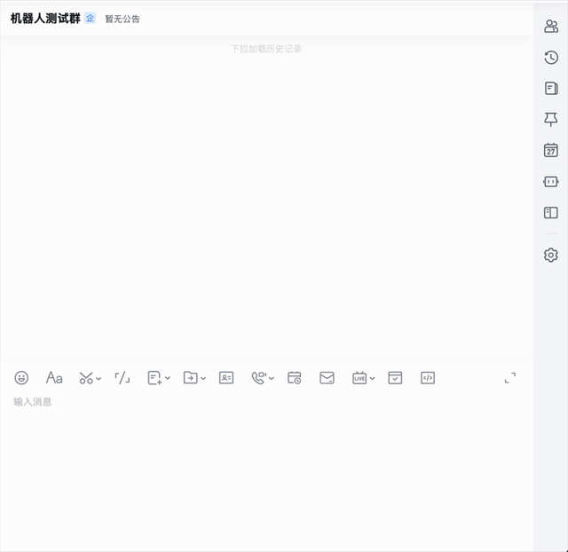

# lockbot

Cluster resource management bot for IM platforms (e.g., Baidu InfoFlow).

Lock and unlock GPU devices, cluster nodes, and queue slots via chat commands.
Runs as a multi-bot platform with FastAPI and a Vue.js frontend.

[中文文档](README_CN.md) | [Live Demo](https://dynamicheart.github.io/lockbot/)

[](https://pypi.org/project/lockbot/)
[](https://github.com/DynamicHeart/lockbot/pkgs/container/lockbot)



## Features

- **Device Lock Bot** — Lock/unlock individual GPUs or devices on a cluster
- **Node Lock Bot** — Lock/unlock entire cluster nodes
- **Queue Bot** — Manage a queue for resource allocation with booking and preemption
- **Platform Mode** — Web UI (Vue 3 + Element Plus) for managing multiple bots, user authentication (JWT), role-based access control, and real-time logs
- **State Persistence** — Bot state survives restarts (JSON file)
- **Bilingual** — English and Chinese UI and bot responses

## Quick Start — Platform Mode (Recommended)

Full management platform with Web UI, multi-bot orchestration, user authentication, and admin panel.

1. Install:

```bash
pip install lockbot
```

2. Set environment variables:

```bash
export JWT_SECRET="your-jwt-secret"
export ENCRYPTION_KEY="your-fernet-key"    # python -c "from cryptography.fernet import Fernet; print(Fernet.generate_key().decode())"
export DEV_MODE="true"                      # dev mode, auto-create admin user
```

3. Start:

```bash
# Backend
uvicorn lockbot.backend.app.main:app --host 0.0.0.0 --port 8000 --reload

# Frontend (another terminal)
cd frontend && npm install && npm run dev
```

4. Open `http://localhost:8000` in your browser.

### Docker

```bash
# 1. Generate ENCRYPTION_KEY and JWT_SECRET
python tools/gen_keys.py

# 2. Pull pre-built image (or build from source)
docker pull ghcr.io/dynamicheart/lockbot:latest
# docker build -f docker/Dockerfile -t lockbot .

# 3. Run (replace the keys with generated values)
docker run -d --name lockbot -p 8000:8000 \
  -e JWT_SECRET=your-secret \
  -e ENCRYPTION_KEY=your-fernet-key \
  -v lockbot-data:/data \
  ghcr.io/dynamicheart/lockbot:latest

# 4. Create super_admin (password auto-generated and printed)
docker exec -it lockbot python tools/create_super_admin.py --username admin --email admin@example.com
```

> **Data persistence**: All data (SQLite DB, bot state files) stored under `/data`. Override with `DATA_DIR` env var.

## Bot Configuration

| Key | Description | Default |
|---|---|---|
| `BOT_TYPE` | `DEVICE`, `NODE`, or `QUEUE` | (required) |
| `BOT_NAME` | Bot instance name | `demo_bot` |
| `CLUSTER_CONFIGS` | Cluster layout (dict or list) | `{}` |
| `TOKEN` | Bot signature verification token | `""` |
| `AESKEY` | Message decryption AES key | `""` |
| `WEBHOOK_URL` | Message webhook URL | `""` |
| `DEFAULT_DURATION` | Default lock duration (seconds) | `7200` (2h) |
| `MAX_LOCK_DURATION` | Max lock duration (seconds) | `-1` (unlimited) |
| `EARLY_NOTIFY` | Notify before lock expiry | `false` |

See `python/lockbot/core/config.py` for the full configuration reference.

## Commands

| Command | Description |
|---------|-------------|
| `lock <node> [duration]` | Exclusive lock (e.g., `lock gpu0 3d`, `lock node1 30m`) |
| `slock <node> [duration]` | Shared lock (multiple users) |
| `unlock <node>` / `free <node>` | Release a specific node |
| `unlock` / `free` | Release all your nodes |
| `kickout <node>` | Force release (admin) |
| `book <node> [duration]` | Queue: book a node for later |
| `take <node>` | Queue: take the current lock |
| `<node>` | Query current usage |
| `help` | Show usage |

## Development

### Dev Server

```bash
# Install dependencies
pip install -e ".[dev]"
cd frontend && npm install && cd ..

# Start backend (port 8002, hot-reload)
bash scripts/dev/backend.sh

# Start frontend (port 8001, proxies /api/* -> localhost:8002)
bash scripts/dev/frontend.sh
```

Both servers support hot-reload — code changes take effect automatically.

### Testing

```bash
# Run tests
pytest

# Lint + format check
ruff check python/ tests/
ruff format --check python/ tests/
```

## Migrating an older standalone deployment

The deprecated Flask entry (`lockbot.core.entry.create_app` / `run_bot`) and process-global
`Config.get/set/load_from_file/load_from_env` API have been removed. Bot construction no
longer starts a private scheduler. The supported deployment is the FastAPI platform above,
including when managing only one bot. Existing platform Docker deployments keep the same
startup command, ports and persistent data layout; no database reset is required.

For an old standalone deployment:

1. Keep a backup of its configuration and JSON state before stopping its old webhook server.
2. Start the platform, create the matching bot type, and copy its cluster, messaging
   credentials and runtime rules into the bot editor. Do not publish credentials in logs.
3. Restore the saved cluster state through the platform's existing cluster-state import
   while the bot is stopped. Verify resource names, holders, expiry and queues before start.
   Do not copy old state over an unrelated bot's directory or remove the old data volume.
4. Point the messaging platform callback at `/api/bots/webhook/{bot_id}` and start the bot.
   Keep the previous image and backup until the new callback and expiry checks work.

The core bot classes remain independently constructible for tests, with per-instance
`Config` objects. Platform scheduling, persisted state formats and legacy state migrations
remain supported. The external XPU monitoring example under `docs/examples/xpu_monitor`
is a separate program; its optional Flask webhook still uses its documented own dependencies.

## License

MIT
