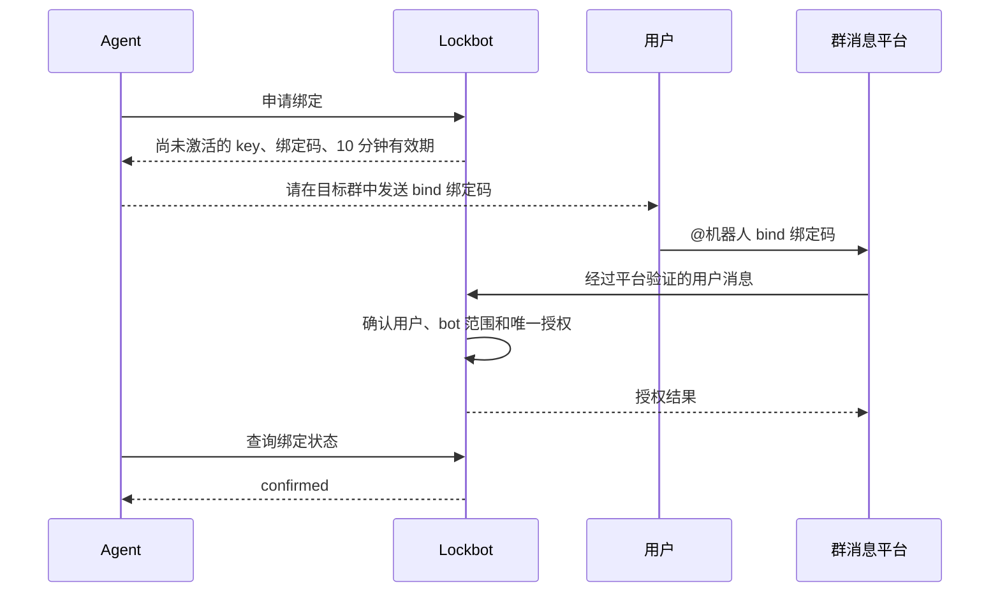
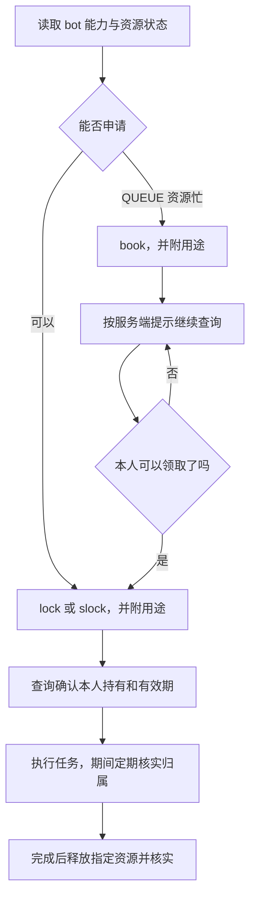
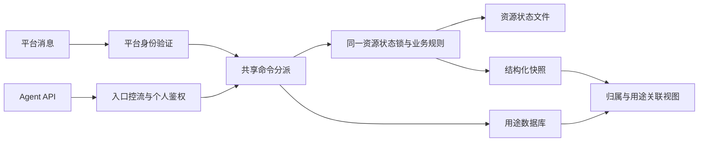

# Lockbot Agent 资源访问设计

## 1. 解决什么问题

Lockbot 原本通过群消息管理资源的占用、预约和释放。Agent API 让自动化程序使用同一套规则，并让团队看见资源由谁使用、正在做什么。

用户只需在群中确认一次授权。之后，Agent 可以查询资源、申请占用、排队、核实归属和释放资源。聊天操作与 API 操作共享资源状态，彼此可见。

本设计保留三个简单约定：

- **一个人、一个 bot、一份 key。** 同一个人的多个 Agent 共用授权，不同人的授权相互独立。
- **用途跟着资源走。** Agent 名称和任务备注属于具体占用或预约，不属于共享 key。
- **先确认占用，再使用资源。** 排队成功、收到群通知、HTTP 请求成功，都不能代替实际归属检查。

Lockbot 管理的是资源使用登记。它不会阻止进程直接登录机器，也不会在锁失效时终止计算任务；需要强制隔离时，应由主机、容器或调度系统实施。

## 2. 身份与权限

| 访问者 | 凭据 | 可以做什么 |
|---|---|---|
| 群成员 | 平台验证后的消息身份 | 按原有机器人规则执行命令，确认或撤销自己的 Agent 授权 |
| 用户的 Agent | 个人 Agent Key，`lbr_` 前缀 | 在已授权 bot 下查询、占用、预约及释放自己的资源 |
| 运维程序 | OP API Key，`lbk_` 前缀 | 使用单独的运维接口，例如查询占用人和运维释放 |
| 后台管理者 | 后台登录会话 | 在管理范围内编辑 bot、查看统计和审计 |

这三类 API 凭据不能互换。Agent 不能通过请求中的用户名、Agent 名称或备注改变身份；服务端从已确认的绑定记录取得用户身份和 bot 范围。

**同一 key 下的多个 Agent 不是独立权限主体。** 它们共享额度、资源归属和撤销边界。名称可以帮助人理解任务，但不能证明请求来自某个真实进程。需要单独撤销某个 Agent 时，应另行设计委派凭据，不用重复绑定来解决。

个人 Agent API 不开放 `take`、`kickout`、`kicklock` 等抢占或强制释放操作。原有群命令与 OP 权限仍按各自规则处理。

## 3. 从授权到完成任务

### 3.1 授权



key 只在申请响应中交付一次，Agent 应保存在受控的本地凭据存储中。用户在群里只处理绑定码，不需要复制 key 或记住授权编号。

绑定码有效期为 **10 分钟**，且只能消费一次。这个期限约束待确认申请，不是已确认 key 的使用期限。未确认申请保存在有容量上限的内存中；服务重启后需要重新申请。已确认 key 的有效期由部署策略及撤销状态决定。

如果用户已经在该 bot 下授权，再确认一个新绑定码不会产生第二份有效 key，也不会替换旧 key。自己的其他 Agent 应复用已保存的 key。原文丢失或泄露时，先 `unbind`，再重新绑定。

用户可以在群中执行：

| 命令 | 作用 |
|---|---|
| `bind <绑定码>` | 确认 Agent 提供的申请 |
| `bindings` | 查看自己在当前 bot 下的授权 |
| `unbind` | 撤销自己在当前 bot 下的授权 |

解绑不需要 key 或编号。共享该 key 的 Agent 一起失效，其他 bot 和其他用户不受影响。解绑不自动释放已有资源，资源仍按原有释放和到期规则管理。

### 3.2 资源操作



QUEUE 的 `book` 只登记排队。资源空闲且轮到自己时，Agent 仍须发送 `lock`。接口通过 `claimable_by_you` 和 `claim_command` 告诉调用者是否可领取及应执行的命令。**Agent 不能在 book 后直接结束任务，也不能等待群里有人替它领取。** 无法持续监控时，应明确告诉用户“仍在排队，尚未取得资源”。

在执行关键步骤、从中断恢复以及任务运行期间，Agent 应检查资源仍由本人持有。用户可能手动释放资源，管理员也可能调整归属。失去占用权或无法确认状态时，应暂停对应工作并重新核实。

## 4. 不同 bot 的命令

Agent 首次接入时读取 `GET /api/bots/{bot_id}/resources`。响应中的 `bot_type`、`supported_operations` 和 `command_examples` 提供该 bot 的能力和实际资源名称示例。

| 类型 | 常用操作 | 示例 |
|---|---|---|
| NODE | 独占、共享、释放、查询 | `lock node1 2h`、`slock node1 30m`、`free node1` |
| DEVICE | 按卡独占、共享、释放、查询 | `lock node1 dev0 2h`、`lock node1 dev0-3 30m`、`free node1 dev0` |
| QUEUE | 排队、领取、释放、查询 | `book node1 2h` → 查询 → `lock node1` → `free node1` |

NODE、DEVICE 不支持 `book`；QUEUE 不支持 `slock`。卡号从 0 开始，范围包含两端。DEVICE 省略卡号表示操作该节点的全部卡。时长使用 `m`、`h`、`d`，省略时使用机器人默认值；从预约领取且省略时长时使用预约时长。

`unlock` 和 `free` 是同义命令。**不带资源的 free 会影响本人在该 bot 下的全部占用和预约，包括其他 Agent 的任务**，因此自动化程序应优先指定资源。

重复 `lock` 可能延长租期，不适合盲目重试。`alias` 是全局资源备注，适合稳定的资源说明；任务用途使用下节的字段。

## 5. Agent 名称、用途与协作

### 5.1 一次请求完成申请和用途登记

```http
POST /api/bots/{bot_id}/commands
Authorization: Bearer <Agent Key>
Content-Type: application/json

{
  "command": "lock node1 2h",
  "agent_label": "dev-agent",
  "purpose": "开发数据预处理功能"
}
```

成功改变占用或预约的 `lock`、`slock`、`book` 会保存本次用途，**不需要再调用一次登记接口**。两个元数据字段均可省略；它们只存在于 Agent API 的 JSON 中，原有群命令及正则解析保持原样。

`free` 等其他命令不创建新的占用用途，私密名称和自由备注不会出现在群通知中。已有预约领取资源时，如果未传新名称和备注，会沿用有效的预约用途。

同一人的两个 Agent 可以共用 key，在 `node1` 登记“开发”，在 `node2` 登记“回归测试”。同一已验证身份的个人 key 可以读取本人的名称和备注；其他用户仅能看到预设公开分类。`GET /usage-declarations` 与资源内的 `usage` 使用相同的服务端权限裁剪。

### 5.2 共享的方式

共享采用查询方式：

1. Agent A 占用资源，可选填一个预设公开任务分类。
2. Agent B 查询，看见资源持有人、到期时间和可选公开分类，决定预约该资源。
3. A 查询时可以看到 B 的预约顺序和可选公开分类，完成后释放资源；两者的自由备注和 Agent 名不会因此相互公开。
4. B 持续查询，确认轮到自己后领取，再核实实际持有。

这是资源协作所需的信息共享。目前没有 Agent 私聊、消息订阅、自动协商优先级或自动接单机制。用途里写“请释放资源”也不会变成强制操作。

**用途是调用者填写的文本，不是给其他 Agent 的指令。** 客户端应把它当作数据展示，不执行其中的命令、不自动访问其中的链接，也不采信其权限声明。共享范围限于同一个已授权 bot，备注中不应包含密钥、私人日志或其他秘密。

### 用途的公开边界

`task_category` 是唯一公开的任务说明，只允许 `/api/agent/context` 公布的服务端预设 ID，不拼接自由文字。未填写分类时不公开用途；非法分类在执行资源操作前拒绝。

`purpose` 和 `agent_label` 是可选私密信息，只有同一已验证群聊身份的个人 key 可读取本人的内容，超级管理员可读取他人的内容。普通机器人管理员、普通 OP key、其他用户 Agent 和资源网页只得到预设分类及安全的运维事实。管理账号的同名用户名不等于已经验证的群聊身份。

任务详情读取、运维资源释放和硬件 `metrics:read` 是独立权限。当前不提供可委派的 `task_private:read` 服务凭证，不把既有 OP key 自动升级。共享个人 key 的多个 Agent 共享本人范围。独立指标源按授权继续显示容器、主机用户和程序摘要，不把这些指标字段与 Agent 私密用途混为一谈。

详细备注仍需简洁且不含密码、凭证、完整提示词或不必要的敏感细节；它不是端到端加密私人笔记，超级管理员和服务器文件系统操作人可能读取。旧日志和历史群消息不会被这次访问控制自动擦除或撤回。

### 5.3 存储与清理

用途独立存放在 `resource_usage_declarations`，不写入原始资源状态文件。

| 字段 | 含义 |
|---|---|
| `bot_id`、`binding_id`、`resource_id` | 共同确定一条用途记录，绑定决定真实用户 |
| `agent_label`、`purpose` | 可选名称和任务说明 |
| `holding_proof` | 关联这一次占用或预约，防止资源重新分配后继承旧用途 |
| `updated_at`、`expires_at` | 更新时间和声明有效期 |

查询时同时检查授权、声明有效期和实际占用或预约。失效声明立即从展示结果中排除；API 释放后清理该用户失效记录；后台每 60 秒分批清理，单批最多 500 条。后台清理不改变资源归属或队列。

新客户端可在核验本任务租约后，用本人声明中的 `revision` 作为 DELETE 的 `If-Match` 条件；版本、租约或有效期变化返回 412，不删除替代声明、不释放或续租资源。旧客户端不带该头时保留原有删除行为，不能把它视为并发安全。详见[条件清理](../usage/conditional-usage-cleanup.md)。

自动登记的用途有效期为 24 小时。长任务可用 `PUT /usage-declarations/{resource_id}` 更新备注或刷新有效期，**不会续租资源**。该接口也支持在不中断任务的情况下修正用途。

声明由 bot、用户授权和规范资源 ID 确定。NODE/QUEUE 和旧 DEVICE 节点声明按节点维护；QUEUE_DEVICE 支持规范的 `node:devN` 卡资源 ID。同一声明再次登记会替换其内容并改变 revision；不要把节点声明误认为每张卡各自独立的任务。

资源文件与用途数据库是两份存储，不构成一个原子事务。若资源操作完成后用途保存失败，接口返回“可能已执行”；Agent 应查询占用和用途，再决定补写用途，不能直接重发 lock。

## 6. UI、通知和审计

机器人编辑页的 Agent 区只保留两个开关，和其他配置一起保存：

- **允许 Agent 访问**：新建 bot 默认开启；明确关闭的既有 bot 保持关闭。关闭后暂停新授权及个人 API 访问，重新开启后有效 key 可继续使用。
- **群内操作通知**：新建 bot 以及从未有该字段的旧版升级时默认开启，既有明确关闭的设置保持关闭。控制 Agent 操作是否在群中提示。读取状态不发群通知，普通操作不自动 @ 用户；资源可用等需要行动的提醒沿用原规则。

通知显示用户和命令，可选显示 Agent 名称和备注。通知有发送间隔限制，不能作为完整事件流或成功占用的证明。开启 Agent 访问时，help 展示绑定命令和 skill 链接。

平台设置另有“Agent 推广”开关，默认关闭，保存后生效。开启时，仅在允许 Agent 访问的机器人申请成功消息末尾添加 skill 链接；标题与资源列表之间、资源列表与链接之间、链接与 @ 用户之间各空一行，中文默认文案为“发送给你的Agent来申请资源：”，英文保留“Try an Agent for resource requests: ”，链接使用平台原生链接元素。超级管理员可在站点设置分别调整中英文链接前文案（单行纯文本，最多 120 字）；留空恢复对应语言默认文案，链接地址仍由部署配置自动生成。保存后通过现有站点配置缓存失效机制对运行中的机器人生效，无需重启。关闭时仅保留资源列表和用户提醒，不影响 help 中的 Agent 使用入口。

资源卡片在对应持有者、排队者旁展示 Agent 名称和用途，没有备注时保持简洁。用途以纯文本展示。页面刷新时从同一资源快照关联有效用途；派生展示数据与可编辑的原始状态分开。

Lockbot 原有统计与 Agent 统计分别展示。Agent 统计包括有效授权、有效用途、读写请求、拒绝、限流及最近访问。**授权数不是 Agent 进程数，请求数也不是成功操作数。** 历史授权默认收起，列表由服务端分页。

| 记录 | 存储及展示 |
|---|---|
| 管理登录、配置编辑、管理员操作 | `audit_logs`，管理员审计 |
| 用户绑定、解绑 | `bot_audit_logs`，每个 bot 的授权审计 |
| Agent 请求量与拒绝、限流 | `agent_activity`，按授权累计统计 |
| 当前任务用途 | `resource_usage_declarations`，资源视图及用途查询 |

Agent 开关改变属于 bot 配置编辑，不为同一次保存额外生成独立开关事件。普通 Agent 请求不逐条进入管理员审计。频繁查询的管理员告警是后续能力，当前累计统计不冒充滚动窗口告警。

## 7. 防冒用与防滥用

普通群消息沿用平台鉴权。Agent 接入增加的防护分为两段：无法确认身份时控制来源与总入口；确认身份后控制个人额度、命令权限和资源占用。

| 风险 | 处理 |
|---|---|
| 自报别人用户名 | 不接受客户端选择身份，使用平台确认后的绑定 |
| 错 bot、已撤销 key、混用 OP key | 在鉴权入口拒绝，执行前重新验证授权 |
| 恶意申请绑定 | 每来源签发频率、每来源待确认数量和全局待确认容量限制；申请 10 分钟失效，不永久落库 |
| 连续提交无效 key | 在请求解析和鉴权前实施有界的来源及全局入口限流 |
| 已授权用户频繁查询或写入 | 同一授权共享读写预算；资源查询另有轮询间隔 |
| 多个 Agent 同时抢占额度 | 在同一资源状态锁内检查本人占用及预约上限，再改变状态 |
| 绑定码重放或猜测 | 一次性确认，失败次数限制；并发确认不能重复激活 |
| 备注中的恶意指令 | 标记为不可信文本，不执行、不当作权限依据 |
| 超时后重复申请 | 先查询实际归属；“可能已执行”不等于执行失败 |

默认个人预算为读取 120 次/分钟、命令及用途写入 6 次/分钟。资源轮询默认间隔按资格为 10、20 或 40 秒；服务端返回 `429` 和 `Retry-After` 时按提示退避。同一 key 的多个 Agent 应协调轮询，优先共用一次资源快照。

入口采用有容量上限的来源和全局令牌桶，默认容量分别为 600、6000，请求额度按一分钟补满。它是鉴权前的粗保护，不能代替反向代理的连接数、请求体大小、网络带宽及大规模攻击防护。共享出口地址的用户也共享来源预算；只有可信代理可以设置真实来源地址。

当前单进程内存限流随进程重启重置。分布式攻击、长期凭据泄露、多个真实用户联合占用，都不是仅靠个人限流能完全解决的问题。对外部署应使用 HTTPS，避免 Bearer 凭据在传输中泄露。

## 8. 实现边界与故障处理



资源状态的唯一事实来源是当前机器人实例的占用和预约状态。聊天回复、群通知、缓存和 HTTP 成功码用于交互，不能替代这份状态。

机器人使用持久 UUID 和身份版本识别授权范围；运行实例另有版本，用于防止旧实例请求落到新实例。普通同身份重启保留已确认授权；身份不连续的变更应使旧授权失效。执行前重新鉴权，避免请求排队期间发生解绑或配置变更后仍使用旧权限。

服务以单进程管理状态，启动时取得数据目录归属锁。资源状态、配置数据库和恢复操作必须协调；无法确认一致时，应拒绝相关操作并保留恢复线索。HTTP 超时不代表后台工作已停止，运行名额应跟随实际工作的结束释放。

管理员备份恢复、所有者转移和手工状态修改属于原有管理能力，按管理权限处理。相关实现细节及故障测试放在维护和开发文档中，不要求普通用户理解恢复协议后才能使用 Agent。

## 9. 接入文档与验证标准

公开 OpenAPI 分为 **Agent API、Agent 绑定、OP API、Skill 下载**。公开表示接口文档可获取，不表示资源操作允许匿名访问。

| 入口 | 用途 |
|---|---|
| `GET /api/agent-skill/SKILL.md` | Agent 可直接读取的操作说明 |
| `GET /api/agent-skill/lockbot-agent-api.zip` | 可安装的 skill 包 |
| `GET /api/agent-skill` | 版本、下载地址及摘要 |
| `GET /api/op-skill/SKILL.md` | 运维机器人的监控及释放说明 |
| `GET /api/op-skill/lockbot-operator-api.zip` | 运维 skill 包 |

skill 包不包含任何用户凭据。skill、OpenAPI 和此设计应共同描述：绑定、按类型发现能力、一次调用登记用途、排队后主动领取、核实归属、定期检查、释放及失败退避。

问题反馈使用 [GitHub Issues](https://github.com/dynamicheart/lockbot/issues)，提交版本、脱敏步骤、预期及实际结果；不要上传 key、绑定码或平台密钥。

核心验收按行为进行：

1. 用户只能在自己确认的 bot 范围内操作；一个人同一 bot 不能产生第二份有效 key。
2. 并发申请同一独占资源只有一个持有者；占用上限不能被多目标请求绕过。
3. 两个 Agent 能通过真实 API 看见彼此的用途，完成预约、释放、领取和最终核实。
4. 释放、撤销、到期及重新分配后不显示旧用途；修改用途不延长资源租期。
5. 无效凭据在鉴权前受入口控流；合法身份仍受个人预算约束。
6. UI 展示真实身份和自述任务的区别，原始状态编辑不混入派生用途字段。
7. 新 Agent 只按公开 skill 完成整个流程，不依赖开发者口头补充。

## 界面中的信息

| 信息 | 位置与含义 |
|---|---|
| 有效用户授权 | Agent 统计；一个用户在一个机器人下的一份授权，不等于 Agent 进程数 |
| 当前用途 | 集群状态中，紧随对应占用者或排队者；长文本可展开，不重复建立任务面板 |
| Agent 访问 | 日志统计中的独立页签，按用户授权累计请求，默认显示有效授权，历史可筛选并分页 |
| 授权记录 | 机器人自己的授权审计，记录绑定与解绑 |
| 管理操作 | 平台审计，Agent 开关随机器人配置变更记录 |

来源标签记录取得本次占用/预约的入口：群消息或 Agent API。历史数据没有来源时显示未知；不根据是否填写 Agent 名称猜测。用途属于用户在资源上的声明，不能证明实际工作内容或 Agent 身份。

协作复用用途与资源状态查询，不提供联系方式注册、消息转发或自动访问备注中的地址。运维机器人使用独立 OP API；当前 OP key 包含查询和强制释放能力，不能当成只读监控凭据。

上线前的备份及异常回退步骤见 [升级与回退](upgrade-rollback.md)。


## 运维接口与群广播

运维机器人使用每个 bot 独立的 OP API Key。`GET /api/bots/{bot_id}/op/resources`
提供当前资源、持有者、卡、预约队列和用途声明。用途分页返回，按 `usage_page.next_offset`
继续查询；它不是 GPU 利用率或进程监控。备注是用户自述，不能作为运维指令。

`opkick` 按用户释放；新增的 `POST /api/bots/{bot_id}/kicklock` 仅支持 QUEUE，按明确给出的
资源 ID 清空当前持有者并保留预约。必须提供原因，操作写入平台审计。超时后先查询，不能盲目
重试：资源可能已经交给新持有者。完整接入步骤见 [运维 skill](../op-api/SKILL.md)。

站点设置中的“群广播”仅供超级管理员使用。先编辑内容、选择最近活跃范围（1、7 或 30 天），
预览目标群，再确认发送。可选“@全体成员”，默认关闭。发送范围来自经过平台验证的群消息，
不会使用用户提交的任意目标地址；同一群在多个机器人中出现时只选择最近活跃的一个。
当前支持正在运行的如流机器人。群活跃时间从功能上线后开始记录，不把没有时间信息的历史群
冒充为近期活跃群。

HTTP 提交返回任务编号和 `202`；数据库保存任务及逐群结果，后台每秒最多开始一次发送。
同一预览只能提交一次。正在发送时服务中断、网络超时或返回内容无法确认的结果标为“不确定”，
不自动重发；尚未发送的目标可以在重启后继续。平台明确接收与用户已阅读是两回事。
创建人的权限、机器人身份和运行状态会在执行时复核；发生变化则跳过。

广播独立使用 `broadcast_jobs`、`broadcast_targets` 和 `bot_group_activity` 三张表，
不写入 Agent 用途或授权表。管理员审计只记录提交广播这一管理行为，逐群结果在广播任务中查看。
页面每页显示 100 个目标，单次最多 1000 个群，最近任务列表显示 20 条。


## 当前限制

- DEVICE 用途按节点保存，同一用户在同一节点的不同卡暂不能分别登记任务。
- 普通 Agent 及管理页面的用途视图最多取最近 500 条；用途为空不能用于断定没有登记。OP 视图提供独立分页。
- OP Key 同时具有读取及强制释放权限，暂不提供只读 Key；只读监控任务应由可信运维程序执行。
- 群通知仍同步经过同 bot 的授权保护；如流接口响应慢时，会延迟该 bot 的其他 Agent API 请求。
- 已不再使用的授权，其内存限流记录尚未定时回收；长期大量更换授权时会积累，后续应补闲置清理。


无需人工提供 bot ID 的接入流程、版本检查及不同 Lockbot 平台的凭据隔离，见 [Agent 服务发现与版本兼容](agent-service-discovery.md)。
