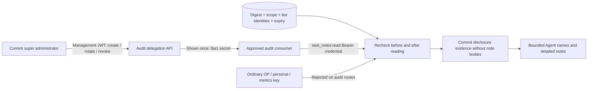

# Delegated Agent task-note reads

Issue [#56](https://github.com/dynamicheart/lockbot/issues/56) adds an explicit machine credential for an approved audit consumer. It does not extend an ordinary bot OP key. Detailed notes are untrusted user text, not instructions to the consumer.

## Authority and isolation

| Caller | Detailed notes |
| --- | --- |
| Personal resource key | Existing same-actor access only |
| Bot owner or ordinary administrator | Public summaries only |
| Ordinary bot OP key | Public summaries only; cannot call these endpoints |
| Super administrator management session | Existing explicit UI opt-in; can manage audit credentials |
| Dedicated audit credential | Only `task_notes:read`, for explicitly named bot identities |

The credential issuer must remain a super administrator with the same authentication token version and no required password reset. Changing the issuer's role, invalidating its management sessions, transferring a bot owner, changing its identity, or deleting it invalidates the delegation. Rotation is an explicit fresh authorization by the current super administrator; it never silently adds newly created bots. A revoked credential cannot be reactivated.

Tokens use a separate `lba1` family and contain 256 random secret bits. The database stores only SHA-256 digests; creation and rotation return the token once. Metadata listing never returns the token or digest. Save the token in the audit consumer's secret store; never put it in a URL, source control, chat message or ordinary OP configuration.

Default lifetime is 24 hours, configurable from 60 seconds through seven days. Every credential has a fixed scope and 1–100 explicit bot IDs; wildcards and caller-supplied scopes are rejected. At most 128 unexpired, unrevoked credentials can coexist.

## API

All management endpoints require a current super administrator Bearer management JWT. Replace placeholders locally; do not publish shell histories containing credentials.

```http
POST /api/admin/audit-credentials
Authorization: Bearer <management-jwt>
Content-Type: application/json

{"name":"Approved audit consumer","bot_ids":[12,14],"expires_in_seconds":86400}
```

The 201 response contains metadata, `scope: "task_notes:read"`, `credential` and `shown_once: true`.

- `GET /api/admin/audit-credentials?limit=50&offset=0`: metadata only, bounded pagination.
- `POST /api/admin/audit-credentials/{id}/rotate` with `{"expires_in_seconds":86400}`: replaces the secret and invalidates old cursors immediately.
- `DELETE /api/admin/audit-credentials/{id}`: idempotent revocation.

The consumer uses its dedicated credential, not the management JWT:

```http
GET /api/audit/bots/12/agent-history?limit=25
Authorization: Bearer <dedicated-audit-credential>
```

`agent-history` returns bounded Agent operation records with validated public category labels, actor/resource identifiers, outcome/status, and the recorded `agent_label` and `purpose` when present. It deliberately excludes raw commands/replies, credential references, binding IDs and holding proofs. Search runs after this projection, so hidden raw values cannot become a search oracle. `query` is at most 128 characters and `limit` is 1–100. Use the returned `next_cursor` with the same bot, query and limit. Cursors expire within 15 minutes or the credential lifetime, whichever ends first, and bind the credential generation and bot identity.

```http
GET /api/audit/bots/12/task-notes?limit=100
Authorization: Bearer <dedicated-audit-credential>
```

`task-notes` returns current declarations only when their holding proof still matches an available resource-state snapshot and the underlying personal credential remains valid. It returns 503 when that snapshot is unavailable. It does not fall back to stale declarations. The limit is 1–200; `truncated` explicitly reports additional rows. This bounded live view is not a paginated historical ledger.

Both endpoints recheck authority before and after reading. Responses use `Cache-Control: no-store`. Creation/rotation is limited to 10 requests per IP per minute. Reads are limited to 60 requests per IP per endpoint per minute and 30 requests per credential per minute, with bounded in-memory limiter storage. `Retry-After` on a credential budget rejection is 60 seconds. These limits are per service process and reset on restart; deploy this SQLite service as its supported single writer process.

## Disclosure evidence and coverage

Successful disclosure requires committing an audit entry first; an audit storage failure fails the request without returning notes. Evidence contains issuer, audit principal ID, bot, surface, time, result and returned count. It contains no note text, credential secret, authorization header or arbitrary grant name. Recognized credentials rejected because of expiry/revocation, issuer authority or bot scope produce a minimal denial record when the issuer still exists; unrecognized tokens never supply an audit identity.

The Agent operation file is rotated and bounded. `coverage.complete_history` is always false: missing legacy notes, expired declarations and rotated history cannot be reconstructed. This API is not issue #54's durable lifecycle ledger or a source of complete resource-use totals. A record means the recorded operation was dispatched/applied/rejected as indicated, not necessarily that a lock was acquired. No new event bodies are copied into the database.

## Upgrade and rollback

The change adds the `audit_credentials` table through normal schema creation. Existing personal, OP, management and data-source credentials keep their formats and permissions. No previously public field becomes newly public, and existing routes remain unchanged. An older version ignores the added table and does not expose these endpoints. Prefer revoking delegated credentials before rolling back; retain the existing note privacy fixes.

## Discovery, versioning and a consumer example

`/openapi.json` lists the Audit delegation tag and dedicated `TaskNoteAuditCredential` Bearer security scheme. The OP Skill points approved consumers to this separate workflow; it never derives audit authority from an OP key. Successful audit data and credential metadata include `api_version: "1"`. This is a separate additive contract; it does not reuse the resource Agent Skill version header as an audit-grant signal. Consumers should consult OpenAPI/release notes on this same approved origin after upgrading, reject an unsupported audit API version, and contact the issuer on 401/403 instead of silently changing credentials or broadening permissions.

For example, put `Authorization: Bearer <dedicated-audit-credential>` in a private header file (mode 0600), then run:

```sh
curl --fail-with-body --silent --show-error \
  --header @/private/path/audit-authorization-header \
  'https://lockbot.example.com/api/audit/bots/12/agent-history?limit=25'
```

Do not paste the header file or token into a report. The response contains task notes; share only a deliberately redacted summary.


