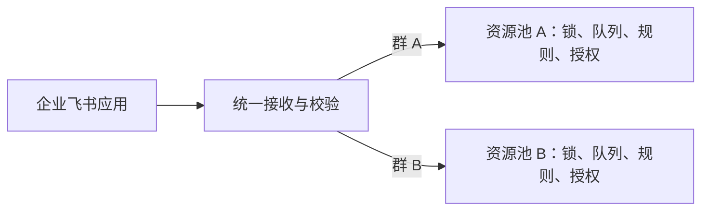

# 飞书与如流并行接入

状态：2026-10-29 更新。实现见 [PR #25](https://github.com/dynamicheart/lockbot/pull/25)，尚未合入或正式发布。测试部署已通过飞书专用代理完成 HTTP API、真实 WebSocket 握手、连接器退出后的重连握手及一次真人群内锁定/回复验收。此前本地重复接收端已停止，测试资源 bot 已从停止状态启动；应用连通和资源 bot 就绪是两项独立检查。正式服务未增加飞书接入。最新范围与未完成事项见 [Roadmap](../../ROADMAP.md) 和 [需求矩阵](requirement-coverage.md)。

## 已确定的产品模型

采用“一个企业飞书应用服务多个资源群，每群独立管理资源”。应用是消息通道，不是资源池；一个接收连接可以服务多个逻辑 bot，不为每个群重复创建应用或建立争抢事件的连接。

- 企业应用配置集中管理 App ID、App Secret、接收凭据、租户身份与接收方式；秘密加密保存，不复制到每个 bot 表单，也不向普通资源管理员返回。
- 使用明确路由 `(application identity, tenant, chat_id) -> bot UUID`。首版每个资源群映射一个逻辑 bot，路由唯一；群名字和显示昵称不能当路由键。资源 bot 沿用自己的数据、规则和生命周期。
- 路由由有权限的管理员明确配置。观察到新群、机器人被拉进新群或收到首次消息，都不自动新建资源池或扩大允许范围。解绑群路由后，旧事件不能继续修改该 bot。
- 同一用户在不同群下的 Agent 授权仍独立，一个用户在同一 bot 下的多个 Agent 共用 key；不能把某群绑定解释为企业全局授权。现有个人 key 自省仍返回其绑定 bot，用户不用管理 bot ID。
- 接收连接生命周期按应用管理，命令执行生命周期按资源 bot 管理。停止一个 bot 不断开其他群的应用连接；停用应用连接影响所有关联群，后台必须说明影响范围。
- 应用可用范围与 bot 资源权限分别校验。管理员能把应用开放给某人，不表示该人可以读取所有群的机器。私聊明确不支持：忽略私聊消息，不执行资源操作、绑定，也不自动发送帮助指引。
- 旧版如流 bot 保持原配置、原平台和原资源状态。共享企业飞书应用不等于把飞书与如流所有资源池合并。

该选择需要新增独立的飞书应用配置与群路由关联。数据迁移采用增量方式，保留已有如流字段、bot UUID/identity revision、Agent 数据和资源状态。应用引用与群路由属于资源 bot 的身份边界；改绑不能让已有授权静默指向别的群或应用。

## 管理员需要准备什么

每个企业只需维护一个企业自建应用，启用其中的机器人能力。各资源群共用这个应用的名称、头像和平台凭证，Lockbot 内部通过群 ID 分别管理资源。首次统一申请所需权限并发布应用；增加资源群通常只需将机器人加入群并配置群与资源池的关联，不为每个群重新创建、审批应用。

“统一审批”不代表以后永远免审。新增权限、扩大通讯录数据范围或调整应用可用范围时，应按企业的应用管理策略重新发布或审核。仅升级 Lockbot 服务代码且不改变飞书应用配置，不等于重新申请平台权限。实际审核人和是否免审由企业管理员决定，不能保证所有企业流程相同。

### 凭证分别做什么

| 配置 | 管理员如何处理 | 用途 |
| --- | --- | --- |
| App ID | 从应用后台复制一次 | 标识企业应用，不是个人身份或资源池编号 |
| App Secret | 从应用后台安全录入一次 | 服务向飞书申请应用访问令牌；仅服务端保存，不发给用户或 Agent |
| tenant access token | 无需手工填写 | 服务自动获取、缓存和刷新，用于调用飞书消息等 API |
| Verification Token | 仅 HTTP 接收方案按要求配置 | 校验事件来源的一部分，不能代替完整的接收校验 |
| Encrypt Key | 仅 HTTP 加密事件方案按要求配置 | 解密及校验回调；不复用如流的 AES 密钥 |
| 个人 Agent key | 用户通过群内绑定获得 | 访问该用户在该资源 bot 下的授权，与飞书应用凭证完全独立 |

长连接使用应用凭证连接飞书，不要求管理员为了它额外填写 HTTP 回调 URL、Verification Token 或 Encrypt Key。后台表单应只显示所选接收方式需要的字段，自动管理访问令牌，不让管理员手工维护全部 key。HTTP 方式则明确展示需要的回调与安全配置；缺少必要校验时不能接收生产事件。

App Secret 等秘密只在安全录入时出现，后续隐藏显示；编辑留空表示保留原值，不在群消息、网页链接、日志或公开设计文档中记录真实值。

### 最小权限与姓名显示

用户在群里操作时，事件已经提供发送者的平台身份。绑定、锁定归属和配额使用带应用／租户范围的稳定 ID，不需要手机号、邮箱或读取整本通讯录。显示姓名和可信身份是两件事：姓名查询失败可回退为平台提及或简短标识，不能导致命令失效或冒用同名用户。

| 功能 | 首版所需权限／事件 | 范围与说明 |
| --- | --- | --- |
| 接收群内 @ 机器人命令 | `im:message.group_at_msg:readonly`；订阅 `im.message.receive_v1` | 只处理 @ 当前应用机器人的消息；不申请读取全部群消息 |
| 回复、排队及到期提醒 | `im:message:send_as_bot` | 以应用机器人身份发送；仍受群、应用及平台规则限制 |
| 展示使用者姓名 | `contact:user.base:readonly` | 按已收到事件的用户 ID 查询必要基本信息，缓存姓名；数据范围限定服务对象，不做通讯录全量同步 |
| 私聊消息 | 不要求 `im:message.p2p_msg:readonly` | 明确不启用，不回复自动帮助，也不据私聊推断资源群 |

这是拟定的功能最小集合，最终以所选官方 API 的权限校验及真实测试为准。`@用户` 使用平台 ID，不需要先获得手机号或邮箱。`@全体成员` 还需核对群设置和平台限制，不能由“可以发普通消息”推断必然可用。

测试企业现有应用曾保留若干历史权限，另有 `contact:contact.base:readonly`；私聊权限不是本项目部署要求。这是现有配置记录，不代表新增部署必须照抄全部已有权限；已实测按 Open ID 查询单个用户基本信息成功；这验证的是现有权限组合，不宣称已单独撤销其他历史权限验证绝对最小集合。当前不为了减少权限而擅自撤销已有授权，也不新增全量通讯录、手机号、邮箱、群历史读取权限。

必须分清三层范围：**应用可用范围**决定哪些人可以使用应用；**通讯录数据范围**决定应用可以查询哪些人的基本资料；**Lockbot 群路由和个人授权**决定可以查看及操作哪一组资源。三者不能互相代替。应用对全企业可用，不代表所有资源网页和 Agent key 对全企业开放。

### 一次性接入与审核步骤

1. 企业管理员或授权开发者创建一个企业自建应用并启用机器人能力；已有应用直接复用。
2. 选择接收方式，配置应用凭证及必要的 HTTP 安全字段，订阅消息接收事件。
3. 按上表申请功能所需权限，设置应用可用范围和必要的用户基本信息数据范围；首轮先限制在测试成员。
4. 创建应用版本，说明用途和权限原因，提交企业管理员审核；审核通过并发布后再验证权限生效。免审与否以企业策略为准。
5. 将同一个机器人加入测试资源群，在 Lockbot 中明确关联该群和独立资源 bot。陌生群首次发消息不会自动获得资源权限。
6. 实测身份、姓名、emoji、链接、@用户、排队提醒及 Agent 绑定；通过后在已批准范围内逐群接入。新增群若涉及扩大应用或数据范围，应先完成相应审核。

后台应显示“未配置、待发布／权限待核对、连接异常、可用”等可诊断状态，并告诉管理员下一步在哪里处理。后台无法核实飞书发布状态时显示待核对，不能仅凭保存了 App Secret 就宣称接入成功。

### 与当前如流接入的区别

| 项目 | 当前如流方式 | 飞书企业自建应用方式 |
| --- | --- | --- |
| 配置单位 | 通常按机器人配置 webhook、Token、AES 密钥 | 企业应用集中配置一次，各群只关联自己的资源池 |
| 接收消息 | 现有如流回调及验签 | 应用消息事件，经长连接或 HTTP 接收 |
| 开通流程 | 沿用已有机器人与群配置 | 应用能力、权限、可用范围、版本发布和企业审核 |
| 发送和提及 | 现有如流消息结构 | 应用访问令牌与飞书消息结构，链接、emoji、@需逐项验收 |
| 使用者标识 | 如流范围内的用户身份 | 应用／租户范围内的平台 ID，不能通过同名自动关联如流用户 |
| 多资源群 | 沿用现有机器人配置 | 同一个应用入多个群，群 ID 路由到独立资源 bot |

这里选择的是能接收事件的**企业应用机器人**，不是只有群 webhook 的自定义机器人。不支持单聊及自动帮助回复；资源操作仅发生在明确配置的资源群中，避免把任务分配到错误资源池。

## 目标

在同一 Lockbot 服务中保留如流，同时增加飞书入口。锁、预约、规则、Agent API 和资源网页继续使用现有业务逻辑，平台适配只负责可信身份、消息接收和展示发送。

实现前的注册表只内置 `InfoflowAdapter`，前端创建表单固定为 Infoflow；有平台接口不等于已经支持飞书。此前的平台无关 webhook 基线 32 项是如流与虚构适配器测试。PR #25 已新增独立飞书适配器、应用配置、群路由和接收入口。已找到 `dev/feishu-handoff-20261028`（`dea5566`），其基于旧 main，不能整支合并。目标仅为飞书和如流，不接入 Slack、钉钉或重做通用聊天框架。

## 旧分支的复核结论

可复用的部分包括飞书 HTTP challenge、AES-CBC 解密与验签、消息正文/mentions 解析、平台凭证 JSON 思路，以及独立 echo 诊断工具。专项测试复跑结果为 **61 通过、3 失败**，与交接记录一致；失败涉及群回复 @ 提及、末尾换行及空正文。先定义预期，再修实现或测试，不靠修改断言掩盖行为。

不能直接复用的部分：

- 原路由通过 `get_instance` 取 bot 后交给 `BackgroundTasks`，未纳入当前 admission/drain 生命周期保护。接收后重启、删除或换配置，可能让旧实例执行任务。
- 去重仅有 10 分钟的进程内字典，重启即丢失；收到并标记后未执行的事件也缺少恢复语义。
- Encrypt Key 和 Verification Token 均空时允许接收，生产必须拒绝这种无身份校验配置。配置加密模式时不能接受明文事件作为降级。
- 能解析 mentions 不等于只响应 @ 自己；必须校验真实机器人身份，不能删掉全部 mentions 后把任意群消息当命令。
- 有发送者 ID 提取，但仍需校验事件的 app/tenant/chat 范围，拒绝陌生应用、群及不支持的发送者。旧分支还会把事件来源群追加到 `group_id`；移植时应沿用当前版本的“配置允许范围”和“观察到的群”分离，观察到不等于授权，不允许首次事件自动扩大范围。
- 逐消息查询联系人姓名可能额外等待 10 秒，不能阻塞锁命令。姓名缓存、失败回退和联系人权限应独立处理，不能因查询失败而认定用户无权限。
- 旧 main 的模型、生命周期、核心命令和数据库定义缺少当前 Agent 身份字段、QUEUE_DEVICE 等能力。不能用旧文件覆盖当前实现，也不能重新引入 Slack SDK 的无条件导入与 standalone。

以上是旧分支的历史复核结果；当前实现及真实验收见文末，不把旧分支测试作为新版本通过的依据。

## 接入方式

| 方式 | 网络要求 | 建议 |
| --- | --- | --- |
| 飞书 SDK 长连接 | 服务能主动连接飞书 HTTPS/WebSocket 服务，不要求公网入站地址 | 企业自建应用优先验证；不用为测试先开放整个平台 |
| HTTP 事件回调 | 飞书能访问专用回调 URL，生产建议稳定 HTTPS 入口 | 已有实现可复用；开发可用 ngrok 一类隧道，正式接入不依赖临时地址 |

长连接作为企业自建应用的默认接收方式，HTTP 保留为可选入口。测试应用已切换到长连接并发布应用配置；不再依赖旧 ngrok 地址。两种传输共用事件归一化、持久认领与命令执行入口，每个应用只启用一种。应用发布版本与 Lockbot 软件版本分别维护。

官方 Python SDK 固定为 `lark-oapi==1.7.5`。SDK 拥有模块级事件循环，因此每个应用使用受生命周期管理的连接器子进程，不在每个 bot 线程启动 SDK。凭证经私有标准输入传递，事件经私有管道交给主进程；主进程完成持久认领后才确认接收。没有新增可绕过认证的公开注入接口，不修改全局事件循环或关闭 TLS 校验。

连接器数量上限 16，断线重启退避 2–60 秒；执行线程 4、等待队列容量 64，排队超过 60 秒的任务不再执行。已验证应用每分钟 240 次、用户每分钟 30 次的接收预算独立于 Agent API 限流。连接失败不阻止如流启动。

## 实现边界

只增加实现所需的四个职责，不引入完整机器人框架。它们是清楚的代码边界，不要求四个独立服务：

1. **接收入口**：HTTP 验证原始头和正文、challenge；长连接依赖官方 SDK 验证通道，二者输出受信任的消息事件。
2. **飞书适配器**：提取文本与真实提及、构造回复、结构化链接与 @，不直接调用核心命令修改资源。
3. **现有命令执行入口**：校验当前 bot 身份与群范围，通过 admission 取得当前实例，在执行期间保留 lease，沿用用户规则、锁、排队和 Agent 绑定逻辑。排队任务不保存旧实例引用；执行前再次检查 bot UUID/identity revision。
4. **飞书 API 客户端**：按应用隔离 token 缓存、单次合并刷新、超时、有限退避及发送结果，不把平台 HTTP 200 直接当业务成功。业务执行和发送结果分别记录。

接收入口、任务队列和发消息都有限额；平台 429/超时不占满其他 bot 的命令线程。无需一开始引入 Redis、分布式 worker、自动建应用或通讯录同步。

## 平台与身份隔离

- 既有 `platform` 缺省值保持 Infoflow，不自动转换已有 bot，不更换如流凭证或回调。
- 飞书应用配置新增专用 App ID、加密存储的 App Secret 及所需接收凭证，资源 bot 只引用允许使用的应用配置及群路由；不要借用如流 AES Key、Token 字段塞入不同语义的值，也不在普通 bot 列表回传秘密。新字段采用增量迁移，保留原有如流字段和读写兼容，不要求已有 bot 重新填写；已有值不展示在 API 列表或日志中。首版不开放应用凭证编辑、轮换或删除界面，也不允许在普通编辑表单中改绑飞书应用／群；这些管理流程后续单独实现。更换平台、应用或租户属于身份变化，不能让此前个人授权自动指向新身份。
- 可信事件校验应用、租户、聊天、发送者类型及允许的群范围。同一应用通过统一接收入口和明确群路由服务多个逻辑 bot，不为每个 bot 建一个互相争抢事件的应用连接。群聊只处理 @ 当前机器人的命令；忽略自身和不支持的消息，防止回复环路。
- 飞书用户采用稳定的平台 ID；昵称只用于显示。绑定、配额、日志和用途都保留平台范围，不能按同名昵称或相同 ID 字符串自动合并如流与飞书身份。多应用、多租户的 ID 范围需明确验证。
- 接入新平台不能沿用其他平台个人 key 的身份。已有 Agent API 路由及如流 key 保持兼容。

“同时支持两种平台”不等于可以复制两个 bot 来管理同一批机器。若迁移期要求两边同时操作相同资源，必须共用同一锁状态与串行执行入口，并显式设计身份关联和多渠道映射；否则会出现两边都认为自己成功占用。首轮测试独立资源，双平台共享资源另行评审，不自动同步或合并生产状态。

## 事件、执行与回复

现有 webhook 路径仍按如流查询参数验签，不能只注册一个新 Adapter 就宣称飞书可用。需要明确飞书原始请求头、正文验证、URL challenge、解密与事件归一化的入口，且原有如流入口保持原样。长连接只接受 SDK 已验证通道中的事件，不与外部任意 JSON 共用“可信”标志。

事件处理分成接收与执行：快速验证并接纳，使用有界队列交给现有 bot admission/lifecycle 机制，再异步发送回复。验收以飞书的响应时限为准；不能把慢命令或发送消息阻塞在接收回调中。

需持久去重，身份至少包含应用范围与消息 ID，不能只靠短期内存或仅事件 ID。最小事件收件记录保存应用与消息 ID、目标 bot 与身份版本、处理状态及时间，保留一天；不保存命令正文、绑定码、整份聊天原文或 App Secret。超过 10 分钟的消息不接纳。处理中的消息在崩溃后属于结果不确定，不能盲目重放 `lock`，否则可能重复续期；明确标记并提供核对途径。当前资源状态文件和事件记录没有跨存储原子事务，因此不宣称 exactly-once。

平台适配保留结构化链接、@用户、排队提醒、到期提醒、Agent 操作通知和消息分段。普通命令回复与需要行动的排队提醒保持适当 @；Agent 操作提示沿用现有 bot 开关，不自动给每条 API 操作增加 @。不直接把 Markdown 链接塞进普通 text 并假定能点击，应使用飞书支持的消息结构实际验收。空正文不单独发送 @，分段不拆坏链接或提及，保留群消息约定的空行。先用普通文本与必要富文本覆盖现有交互，不先做复杂卡片 UI。发送失败与业务命令结果分别记录，避免“发消息失败”被当作命令未执行而重试。

`@全体成员` 独立核对飞书权限与群限制；首次联调不广播到未知群，不自动申请读取全部群消息或通讯录的权限。先申请接收群内 @ 和发送消息所需的最小权限。

## 落地与边界

[PR #25](https://github.com/dynamicheart/lockbot/pull/25) 包含实现所需的应用配置、群路由、官方 SDK 长连接、可选 HTTP、安全校验、富文本回复及备份恢复。新增三张飞书专用表，不改写已有如流凭证、个人授权或资源状态。使用指南见该 PR 中的 `docs/usage/feishu.md`。

利用率集成和消息画廊工具独立提交。不做跨平台共享同一资源池，不支持单聊或修改已创建 bot 的平台；迁移复制配置到新 bot，并避免新旧入口同时发放同一物理资源。动态改绑群和应用凭证轮换 UI 不属于本轮交付。

## 验收与上线

1. 审阅已有分支、凭证管理与隧道配置，只读取必要信息，不回显 App Secret。
2. 本地测试签名/鉴权、challenge、正文解析、群范围、用户隔离、重复事件与超时。
3. 在测试企业中选定应用和测试群，使用虚构 NODE/DEVICE/QUEUE/QUEUE_DEVICE 资源验证查询、lock/book/free、轮到自己后的 lock、提醒、用途、bind/bindings/unbind 与网页链接。
4. 测试停止、重启、断网重连、修改凭证、队列满和发送失败，确认不重复执行、不残留连接。停止状态下的 HTTP challenge 可经校验正常响应，普通命令不得修改资源；有条件发送“未启动”提示，但不绕过群范围校验。
5. 并行运行如流和飞书测试 bot，完成相同的资源流程；继续运行全部如流验签、解析、格式与生命周期回归。现有 32 项适配基线只是起点。
6. 独立 PR 上线；先开测试 bot，再逐个启用飞书。回退时先停止新平台连接器及尚未兼容的 bot，不改写或删除如流配置、数据和 key。

## 后续验收与已确定边界

- 测试企业已核对应用及已发布权限，真实业务在一个授权群完成；多个群的隔离已有回归测试，仍需后续多群实际部署验收。
- 长连接为默认方案，不依赖 ngrok 或公网入站 IP；若另选 HTTP 回调，单独配置稳定 HTTPS 入口。
- 用户已明确不做双平台共享资源池、单聊或既有 bot 平台切换，不把这些事项重新列为待确认功能。

## 开源实现借鉴

| 参考 | 借鉴点 | 不移植的部分 |
| --- | --- | --- |
| OpenClaw 飞书插件 | 按账号隔离客户端和配置；区分处理中认领与持久去重；连接退出/重连；结构化 mentions；限制 webhook 请求体与超时 | LLM 会话、流式卡片、文档工具、复杂授权交互和通用插件平台 |
| NoneBot2 飞书适配器 | API 客户端、HTTP/WS 接收与标准事件模型分离；在启动/停止时管理连接任务 | 整个 NoneBot 运行时；不照抄其 challenge 或鉴权顺序来取代自己的校验 |
| 官方 SDK | 平台协议、API 模型、凭证生命周期及接收机制 | 不默认最新版一定符合本服务多 bot 生命周期；固定版本并测试 |

OpenClaw 的持久去重说明，消息在重连和重启后仍需识别；它对磁盘失败采用的退化策略不一定适合会续租资源的命令。Lockbot 若无法写入必要去重/收件记录，不能仍宣称可靠接纳并执行变更。NoneBot 的接收/发送分离值得参考，但开源代码不是安全性或精确执行保证，仍需自己的负面测试。

## 参考

- [飞书事件概述](https://open.feishu.cn/document/uAjLw4CM/ukTMukTMukTM/event-subscription-guide/event-subscriptions)
- [飞书 Python SDK 事件处理](https://open.feishu.cn/document/uAjLw4CM/ukTMukTMukTM/server-side-sdk/python--sdk/handle-events)
- [官方 Python SDK](https://github.com/larksuite/oapi-sdk-python)
- [SDK 多实例事件循环问题](https://github.com/larksuite/oapi-sdk-python/issues/119)

以上 SDK 判断基于调研时的源码与上游问题；实现时必须重新核对实际选择的发布版本，不把主分支代码等同于已安装版本。

- [OpenClaw 飞书实现](https://github.com/openclaw/openclaw/tree/main/extensions/feishu)
- [NoneBot2 飞书适配器](https://github.com/nonebot/adapter-feishu)

- [企业自建应用发布与使用](https://open.feishu.cn/document/client-docs/h5/development-guide/step-4)
- [自建应用发版审核指南](https://www.feishu.cn/hc/zh-CN/articles/374230668270-自建应用发版审核指南)
- [接收消息事件](https://open.feishu.cn/document/server-docs/im-v1/message/events/receive)
- [发送消息接口](https://open.feishu.cn/document/server-docs/im-v1/message/create)

## 真实消息画廊进展（2026-10-29）

已用现有企业应用向明确授权的测试群发送 55 条主样例，覆盖四种 bot 的核心回复、emoji、链接、真实用户及全体提及，并补发三个修正的 DEVICE 样例。姓名查询成功，没有新增平台权限。脚本、单元测试与实际测试限制单独维护在 [PR #23](https://github.com/dynamicheart/lockbot/pull/23)。

客户端已核对 emoji、真实用户／全体提及及样例空行；点击帮助中的平台链接，浏览器成功打开 Lockbot 页面。普通文本提及标记保持普通文字。画廊本身只证明渲染；最初旧 ngrok 接收失败的问题，已在后续长连接业务验收中解决。没有申请全量通讯录权限。

## 真实业务验收与剩余工作（2026-10-29）

在授权测试群中，官方 SDK 接收真实用户 @消息，经过当前后端和核心命令执行，再由飞书原生富文本回复，验证了：

- 直接查询、手工锁定、实际到期提醒及真实用户提及。
- 用户在群内完成 Agent 绑定；个人 key 可以取得平台为 Feishu 的 context。
- 一个 Agent 持有资源，真实用户排队；释放后收到可用提醒，再通过真实个人 key 执行 lock，确认占有后显式释放。
- 另一个 Agent 查询得到占用者的 Agent 名称和已公开用途；用途随释放清理，个人 key 保留。
- 后台应用表单默认只要求长连接必需字段；切换 HTTP 后才显示租户、Verification Token 和 Encrypt Key。

PR #25 当前代码六项 CI 通过；含监控、利用率和推广配置的组合版本后端／核心测试 1387 通过、7 跳过，前端 86 通过，构建与静态检查通过。备份与跨数据库 ID 重映射已通过隔离演练。

测试部署保留原代码基底和现有应用/群路由/凭据，应用飞书专用代理与握手补丁后，HTTP token/机器人身份查询、真实 WebSocket 握手及退出重连已通过。代理覆盖 API、SDK 握手和 WebSocket，不修改全局 HTTP 代理或如流配置；当前为部署级飞书专用设置，尚非逐应用后台代理 UI。此前本地接收端的 loopback 回复链接暴露了重复实例，已停止该端并加防误启动提示；同时启动已关联但仍停止的资源 bot。随后真人群内 120 秒锁定及回复通过，链接指向测试服务。服务接收至平台接受约 2.1 秒，接收时间戳精度为秒，不代表手机端总延迟。

本地已恢复真实长连接，并实测一条 Agent API lock 与一条真实飞书群 lock 在监控中分别计一次。站点设置新增平台启用范围，关闭只限制新建，不停已有 bot；通过 UI 保存后实际新建请求返回 403，已有 bot 保持运行，验收后恢复默认开放。后续部署事项为多群实际生产验收、应用凭证轮换管理界面及网络可用环境的上线；本地及远端测试通过均不代表正式服务已上线；部署验收还须确认应用只有预期接收端、资源 bot 运行、回复地址正确，并覆盖如流和多群隔离。
