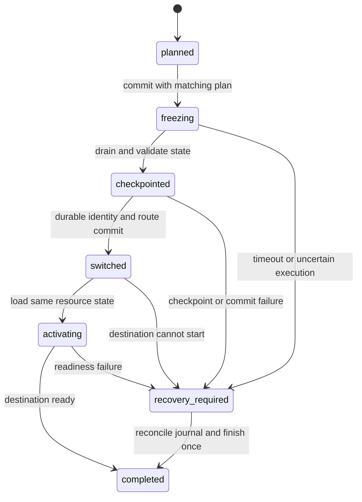

# Infoflow → Feishu resource-bot migration

Status: implementation plan, 2026-10-30. Tracked in [#88](https://github.com/dynamicheart/lockbot/issues/88). No production migration has run. This supersedes the previous copy-only decision for this direction; copying configuration remains a separate operation.

## Product behavior

An administrator opens **Migrate to Feishu** in the existing bot's detail page, selects an approved enterprise application and destination group, reviews blockers, and confirms a cutover. The same resource bot retains its ID/UUID, inventory, rules, utilization configuration and history. Its messaging identity changes. The source group stops accepting resource changes before the destination becomes writable.

One migration has one scheduling authority. This is a channel handover, not two bots with independent state and not concurrent cross-platform access. Existing Infoflow bots outside the selected migration remain unchanged.

Delivery is split into independent PRs:

1. Plan, preflight and durable empty-state cutover/recovery. Existing locks, reservations and pending offers must finish naturally; nothing is silently released or deleted.
2. Administrator UI and integration acceptance.
3. Verified identity linking and active-state migration. Preserve absolute deadlines, queue order and provenance. An unresolved user blocks this mode. Empty-state delivery alone does not complete active migration.

## Identity and data boundaries

| Item | Treatment |
| --- | --- |
| Bot ID/UUID, resource names and allocation authority | Preserve; do not create a second resource pool |
| Inventory, aliases, platform-neutral duration/renewal/quota rules, language, metrics configuration | Preserve and include in plan digest; identity-bearing exceptions require separate mapping |
| Infoflow webhook/token/AES | Keep an encrypted source-configuration reference for controlled rollback; fence its authority in the typed application registry as well as legacy fields. Never repurpose it as Feishu fields or expose it in preview |
| Feishu application | Reference the existing approved application; validate tenant/app/chat and bot membership; do not copy its secret into migration records |
| Platform user identity | Treat Infoflow ID and Feishu tenant/application-scoped Open ID as different principals; never match by name |
| Personal Agent keys | Invalidate source authority at cutover through identity revision; require destination group re-enrollment. No silent cross-platform transfer |
| OP key | Clear the current key before opening destination admission; reissue explicitly. Current OP authentication compares `Bot.api_key` without a revision check, so a revision bump alone does not revoke it |
| Detailed-note audit grants, read windows, metrics grants and resource-view links | View/audit authority checks revision. Existing metrics JWTs do not carry revision and the independent gateway cannot instantly revoke them: stop issuing source grants, wait out their configured maximum TTL plus verifier leeway and actual clock skew before destination admission (the bundled gateway currently allows 15 seconds of leeway, so its five-minute grants require at least 315 seconds after issuance is stopped), or add and deploy gateway revocation support first. Previously disclosed data cannot be revoked |
| Old logs/history and detailed notes | Preserve original platform, principal and revision; historical access stays within current role/delegation rules. Do not relabel old events as Feishu events |
| Pending notifications, broadcasts, query panels and bind codes | Fence old revision; do not deliver source payloads to the destination group |

Do not put credentials, raw group messages, task notes or personal identity mapping proofs in the public plan or audit summary. Migration journal stores references and digests, not secrets. Retention/deletion of identity-link proofs needs its own bounded policy.

## Preflight and review

Preflight is read-only. It returns source identity revision/configuration digest, target application/group references, allocation counts, unresolved identity count and explicit blockers. A preview is not a reservation or permission to commit later.

Checks include:

- Current super-administrator authority. The ordinary bot update endpoint remains unable to change platform.
- Supported source type/platform, stable bot UUID, healthy recoverable state and no competing lifecycle operation.
- Destination application exists in the expected tenant, server-side credentials validate, proxy/receiver is available, and the application can access the target group.
- Unique `(application_id, chat_id)` and bot route; reject another bot's binding without overwriting or transferring ownership. This restriction is Feishu-specific.
- No pending unknown-result command or incomplete lifecycle journal. Empty-state mode checks locks, books, offers and pending handoffs, not only a utilization counter.
- Review old/new group, retained settings, keys requiring re-enrollment, outstanding work and expected interruption. Confirmation is tied to an expiring plan digest, not an arbitrary target submitted afterwards.

Application publication and group membership are external facts. They are checked as closely as practical to commit, but provider/network failures remain possible. A destination failure must leave scheduling frozen or recoverably stopped; it must not restore a second writer automatically.

## Cutover protocol and crash recovery

Proposed additive `bot_migrations` records have an unguessable operation ID, bot UUID, source/target revisions, target references, plan digest, phase, state-checkpoint digest and result/error code. An active-operation constraint and the existing lifecycle transition owner protect the same bot. A JSON file plus a DB commit is not an atomic transaction; checkpoint publication and DB phases require explicit recovery.

Execution requirements:

1. Acquire the lifecycle transition owner before rereading configuration. Persist admission freeze; all mutation entry points, including Agent/OP, webhook/WS, scheduler and restart/autostart, must honor it. An in-process flag alone does not survive a crash.
2. Retire source generation, reject new writes and drain admitted operations. A drain timeout is an uncertain result, not permission to replay commands or start the target. Keep the checkpoint compatible with scheduler/expiration behavior.
3. Reread state and compare the plan. In empty-state mode any live lock/book/offer aborts before identity switch. In active mode every live principal and provenance reference must have a verified mapping.
4. Drain and durably settle the source lifecycle outbox before changing revision: recovery currently rejects envelopes from another revision. Preserve old frames unchanged and create a destination-revision baseline/coverage boundary; never relabel old frames or discard pending evidence. Write and fsync the checkpoint and operation evidence before switching. Transactionally update the platform/application/route, bump revision, fence old credentials/notifications and record switched phase. Enforce unique group binding in the DB as well as preflight.
5. Load the same bot's state, apply only validated identity mapping if requested, then start the Feishu generation. Keep it frozen until readiness and state digest checks pass. Record completion before opening mutation admission.
6. Retrying the operation ID returns/reconciles its existing result. A different target or digest conflicts. Startup discovers incomplete operations and keeps them unavailable until reconciled; it must not autostart the obsolete channel.

A verified externally changed target route or source snapshot blocks recovery for operator review. Never infer success from a prior HTTP timeout or `status=stopped` alone.

## Active locks and identity linking

Users prove control of both accounts using short-lived, single-use challenges through signature-verified source and destination messages. The challenge is scoped to instance, bot UUID, migration ID, source revision and target tenant/app/chat. The existing Agent key can identify the source principal but is not proof of the destination identity. Names, contact search results and an administrator's guess are not proof.

`DURATION_WHITELIST` contains platform-native user IDs, so even an empty-state migration must explicitly map, remove or rebuild these entries. Scan all identity-bearing overrides rather than copying them as ordinary scheduling settings. Usage-declaration holding proofs include user/start/holding identity: revalidate or rebuild current proofs under the destination principal while retaining source attribution; do not transfer source-key authority.

A separate, explicit administrator-assisted override, if needed, must show exact principals, require a reason and audit the decision; it is not an automatic fallback. Duplicate mappings, many-to-one ownership/quota conflicts, missing users or changed destinations block cutover.

Keep original lease IDs, reservation sequence, acquisition times and absolute expiration timestamps. Migration elapsed time does not extend locks. Expired entries are reconciled as expirations with evidence, not copied into new leases. Pending reservation offers require an explicit transfer/expiry policy; do not silently grant a queued user a lock. Detailed-note ownership and cleanup tokens must be revalidated against the mapped principal and revision; preserve historical attribution separately.

Destination Agent re-enrollment can happen after linked users are established. It must recognize a transferred allocation without issuing a duplicate lock; old keys remain rejected.

## Rollback

Before identity switch, recover the source generation only after proving the target never became writable. After switch, use a controlled reverse migration with the same freeze/drain protocol and current state; never restore an old DB/state snapshot over newer allocations. Credentials and links do not become valid again by decreasing the identity revision. Revisions increase monotonically, and source credentials need explicit replacement/re-enrollment on a reverse move.

Backups are disaster-recovery evidence, not a cross-platform undo button. Preserve database/state/encryption keys together. A code rollback to an older version unaware of migration phases is unsupported while a migration is in progress.

## Acceptance gates

- Existing Infoflow message formatting, resource commands and same-group multiple-bot behavior remain unchanged outside a migration.
- Permission and route takeover denial; stale plan, revoked application, cross-tenant and concurrent cutover conflicts.
- Freeze all write paths; source delivery delayed until after cutover cannot mutate the target.
- Fault injection before/after checkpoint publication, identity transaction and target activation; process restart does not create a second writer or replay allocations.
- Old Agent/OP/view/audit/metrics access is denied to the extent promised, with a documented short-lived-grant policy; public schemas do not disclose detailed audit authority.
- Real integration migration in a fictional group, empty-state and active-state modes separately; exact deadlines, queue order, notes ownership and history attribution are compared before/after.
- UI exposes phase/blockers/recovery without secrets, resets old request/download state on bot switches, and does not claim a timeout rolled back.
- Current-head CI and independent review precede squash merge; a tagged artifact, formal deployment and corporate-app approval are separately verified.
