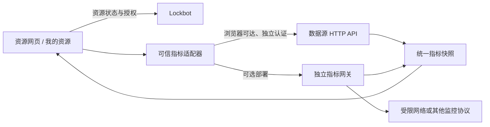

# 指标数据源插件协议 v1

状态：2026-11-14，**版本化接入规范 / 实现目标**。本文定义与 Prometheus 无关的统一指标模型和适配器边界；不是已经发布的第三方插件 SDK。当前产品实现的适配器仍为 Prometheus，普通 HTTP JSON 适配器及个人资源台指标关联尚未交付。不得仅根据本文配置一个新 `type` 就宣称可用。

## 1. 目标与边界

资源系统回答“谁占用、预约了什么、何时到期”；指标系统回答“设备与主机当前运行怎样”。两者独立，指标不参与锁定、释放、续期或抢占决策。零利用率不等于资源空闲，锁定时间不等于硬件利用率或工作产出。

协议支持 Prometheus、自定义 HTTP JSON、其他受控监控 API。采集方式（SMI、exporter、主机代理）和存储方式（时序库、缓存、外部服务）不在页面协议内强制统一。不依赖 MPI，也不要求上游部署 Prometheus。



Lockbot 管理非敏感配置和资源权限，可选签发指标授权；不因本协议新增硬件采集、指标存储或查询代理职责。指标网关由数据源维护方独立部署。浏览器直连失败不自动回退到 Lockbot 服务端请求。

## 2. 两种插件不能混为一谈

| 插件 | 输入与输出 | 执行位置 |
| --- | --- | --- |
| 资源 Reporter | 已核验身份 `grant` → 本人持有与预约记录 | Lockbot 服务端、管理员安装的 Python 模块 |
| 指标适配器 | 明确资源映射与指标专用授权 → 本文统一快照 | 可信前端内置代码；必要时由独立网关转换 |

`create_reporter(config).report(grant)` 的既有接口见 [个人资源台](personal-resource-panel.md)，不能把 CPU、显存直接塞入授权或占用记录，也不能让 Reporter 暗中成为任意 URL 代理。内部系统适配代码、资源目录、身份桥接和运行密钥可在独立私仓维护；公共仓库仅保留通用规范与脱敏示例。

## 3. 配置与能力发现

一个数据源实例须有稳定 `datasource_id`、适配器类型及主版本、批准的目标 origin、访问模式、刷新/过期策略、显式节点和设备映射。名称仅供展示，不是身份或授权依据。配置不得包含运行密钥、Cookie、个人 Key、OP Key 或管理 JWT。

适配器能力描述至少包含：

- `protocol_version: 1` 和稳定适配器 ID；不能根据产品名称猜协议。
- 支持的指标 ID、实体类型（`host` / `accelerator` / `filesystem`）、可选进程详情能力。
- 支持的认证方式、建议刷新周期、最大目标数与响应限制。
- 时间与单位语义；不支持的指标省略，不能填假零。

能力可以由内置适配器静态声明；无需强迫旧数据源新增 discovery API。数据源实例地址、配置代次、bot UUID 或授权范围变化时，应取消旧请求、清除旧指标，只接收新代次响应。

## 4. 统一快照模型

[完整脱敏 JSON 示例](../examples/metrics/snapshot-v1.json) 是 v1 的规范性示例。顶层字段：

| 字段 | 语义 |
| --- | --- |
| `protocol_version` | 整数 `1`；不支持的主版本明确拒绝 |
| `datasource_id` | 当前配置实例 ID，必须匹配请求；不作为 ACL |
| `generated_at` | 快照封装时间，RFC 3339 且有时区；不是硬件采样时间 |
| `coverage` | `complete` 或 `partial`，只针对此次明确请求的目标集合 |
| `entities` | 已映射实体；每个实体有稳定 ID、类型、节点 ID、可选设备 ID及指标数组 |
| `errors` | 结构化局部错误；只含已授权目标和安全错误码，不含凭据、内部堆栈或原始响应 |

实体唯一键为 `(datasource_id, kind, id)`；映射后的资源键还须带服务实例、bot UUID、node ID及可选 device ID。不同服务的同名 `node1` 或 `dev0` 不得自动合并。NODE/QUEUE 类型也可展示节点下的多张卡，不把它们平均成一个数。设备必须按稳定标签/UUID显式对应，不能按返回数组位置猜卡号；重复、冲突、缺失映射标为未知。

每个指标包含 `id`、`unit`、`value`、`status`、`observed_at`：

- `status` 为 `ok`、`unknown`、`failed`、`stale`、`unsupported` 或 `invalid`。
- `ok` 必须有有限数值及真实源采样时间；无可用值时 `value: null`。不允许 JSON NaN/Infinity，也不把字符串直接当数值。
- `stale` 可保留上次有效数值与原采样时间，但必须明显标记。不能用 `generated_at`、HTTP 成功时间或 Prometheus 求值时间冒充新采样。
- 时间使用明确 `Z` 或偏移；内部按同一 UTC 瞬间比较，中文界面的人类时间按明确 UTC+08 展示，不能给 epoch 算术加八小时。
- 客户端须再次按采样时间和配置的 `stale_seconds` 判定过期，不能只信上游 `ok`。异常未来时间标为 `invalid`，不用截成“刚刚”。
- `partial`、缺目标、缺指标、身份/授权失败不能表示全体零负载或零占用；一个失败实体不应抹掉其他健康实体。

### 标准指标

| 指标 ID | 单位 | 范围 / 说明 |
| --- | --- | --- |
| `accelerator.utilization` | `percent` | 0–100，每卡；不平均掩盖忙卡 |
| `accelerator.memory.used` / `.total` | `bytes` | 非负，total > 0，used ≤ total |
| `host.cpu.utilization` | `percent` | 0–100；采样窗口内主机总体利用率，需差分基线时首样为 unknown |
| `host.memory.used` / `.total` | `bytes` | used 定义为 total − available；与不同 free 输出口径须显式转换 |
| `host.memory.available` | `bytes` | 操作系统可用内存估计，不等于空闲内存 |
| `host.memory.buff_cache` | `bytes` | Linux 示例口径 Buffers + Cached + SReclaimable；不同源需声明转换口径 |
| `filesystem.used` / `.total` | `bytes` | 每文件系统；不用含糊“磁盘使用”代替字节容量 |

available、buff/cache 可能在语义上重叠，不能与 used 相加当作独立分区；缓存大也不能单凭此项断言驱动不会 OOM。文件系统的容量、可用和保留块口径必须一致。扩展指标使用组织命名空间（如 `vendor.example.temperature`）及明确单位，不覆盖标准指标，不下发 HTML 或可执行表达式。

## 5. 适配器接口

以下是**拟议的统一接口**，不是现有 JS export。实现接入时需加兼容桥，将当前 Prometheus 内部 `cards` / `hosts` 快照转换为 v1，不能直接改旧组件输入并破坏已发布配置。

```typescript
interface MetricsAdapterV1 {
  describe(): CapabilitiesV1;
  validateConfig(config: PublicConfig): ValidationResult;
  query(request: {
    config: PublicConfig;
    targets: Target[];
    credential: MetricsCredential | null;
    signal: AbortSignal;
  }): Promise<SnapshotV1>;
  testConnection(request: QueryRequest): Promise<ValidationReport>;
}
```

`targets` 必须是已授权、已映射目标；认证对象运行时注入，不能放进 `PublicConfig`。`query` 必须响应取消、约束响应大小与目标数量、不跟随携带凭证的跨 origin 重定向。`testConnection` 检查实际查询、时间、格式与映射覆盖率，不能只请求 health 返回 200；结果只证明当前测试客户端当时可达。

不从配置 URL 动态下载执行 JavaScript，不允许用户输入任意 Python 模块。当前前端适配器为构建时注册的可信代码；新增第三方执行环境、热安装或插件市场需另行安全设计。

## 6. 两种接入示例

### Prometheus 适配器（当前已实现）

使用现有 `/api/v1/query`，根据配置白名单查询并规范化单位/真实采样时间。现有 profile、认证、标签映射、单页轮询与部署包保持不变；其 HTTP 协议不被本文替代。实现参见 `frontend/src/utils/utilization/prometheus.js`，使用说明见 [网页利用率](../usage/browser-utilization.md)。

### 普通 HTTP JSON 适配器（待实现）

数据源可已有任意受控 API，由可信适配器做字段转换；完全不要求 PromQL 或时序库。若新建网关，可采用下面的**参考 HTTP profile**：

```http
POST /v1/metrics/snapshot
Authorization: Bearer <metrics-only-credential>
Content-Type: application/json

{"protocol_version":1,"targets":[{"node_id":"node-a","device_ids":["card-0"]}]}
```

成功返回本文快照，`Cache-Control: no-store`，Content-Type 为 `application/json`；请求/响应不含 Lockbot 原始凭证。401 表示无效/过期授权，403 表示目标越权，422 表示版本/请求不支持，429 可带 Retry-After，503 表示数据源暂不可用。部分采集失败可返回 200 + `coverage: partial` 和安全错误码，但不能把认证/越权失败包装成空的成功快照。该路径是参考约定，不是当前 Lockbot 新增接口；现有数据源无需改造为此路径。

## 7. 授权、隐私与网络

- 每个数据源自行认证与执行 ACL。浏览器直连只能发送该源专用凭证，不复用 Lockbot 个人 Key、OP Key、后台 JWT、网页码或浏览器管理 Cookie。只读也不代表公开。
- 数据源可选独立认证，也可显式信任 Lockbot 短期 `metrics:read` 授权。后者只对事先登记的信任域有效，不是任意 JSON 服务天然认识 Lockbot token；现有最长 300 秒规则不因网页长期链接改变。
- 服务器/网关必须约束节点、卡或指标范围；前端 `targets` 过滤不构成授权。现有网关是节点级，不能据此声称已实现逐卡或逐用户进程隔离。
- 容器名、主机用户和脱敏命令摘要是可选敏感详情，由源端单独授权后按需读取；不要默认返回完整命令行、环境变量、凭据或其他人的 Agent 备注。容器观察不等于经核验的群聊用户归属。
- 浏览器需满足数据源 CORS、HTTPS 混合内容和本地网络访问策略；裸 IP 同样有跨域。Agent 没有 CORS 限制，但仍需网络路径与授权。独立网关不是绕过 IT 网络边界的手段。
- 未配置不查询、不留占位列；失败只影响指标，不阻塞资源与预约读取。个人资源台按资源映射加载指标，不为获得指标而自动扩展资源授权。

[指标访问与授权边界](telemetry-authorization.md) 详细说明已实现的短期授权、失效与网关约束。

## 8. 刷新与性能

采集周期和查询周期独立。硬件采集默认每 300 秒、错峰进行；SMI 可能占驱动锁，网页点击或轮询不能触发即时全卡采集。上游已有缓存时尊重缓存。

每个页面/数据源最多一轮查询在途，批量目标、限制并发、配置超时、响应字节数与实体数上限。429 服从 Retry-After，其他错误有限退避；手动刷新也不能绕开预算。页面隐藏/离开、会话失效、切换 bot/数据源应取消旧请求，迟到响应不得串入新页面。恢复可见最多补一轮。

适配器的 `describe()` 应公布上限，宿主设置不可放宽的保护上限。建议 v1 宿主上限为 1 MiB 响应、512 个目标、2048 个实体、2 个并发 HTTP 请求、15 秒单轮截止；低于源端要求的值优先。默认刷新不应快于源端建议采集/缓存周期。值为 unknown 时不要反复刷新尝试“刷出”数据。

## 9. 版本兼容与接入验收

同一主版本只增可选字段，保留既有字段语义；消费者忽略未知可选字段/扩展指标，但未知状态按 unknown 显示。删除字段、变更单位/身份含义需新主版本。源方可继续原协议，由适配器翻译，不强迫旧 Agent 或现有配置升级。

- [ ] 与旧 Prometheus 配置并行，旧配置和既有短期授权无需重建。
- [ ] JSON 样例与适配器验证器一致，0/未知/失败/过期/unsupported 可区分。
- [ ] 普通 JSON、Prometheus 对同一模拟设备输出等价规范化结果。
- [ ] 显式稳定映射、重复设备、乱序设备、缺卡及 NODE 展示逐卡指标验证。
- [ ] 未授权/过期/越界、跨源重定向、凭据不泄露与详情权限验证。
- [ ] 取消、会话与配置切换、慢响应、429、批量/大小限制验证。
- [ ] 数据源不可达时锁与队列正常，所有新指标展示均为 best effort。
- [ ] 管理员测试不能宣传为所有用户网络验收成功。

以上是接入新适配器的验收门槛，并不表示已经全部实现。协议后续实现与交付状态统一跟踪 [#139](https://github.com/dynamicheart/lockbot/issues/139)，避免将文档 PR 当成运行功能发布。
