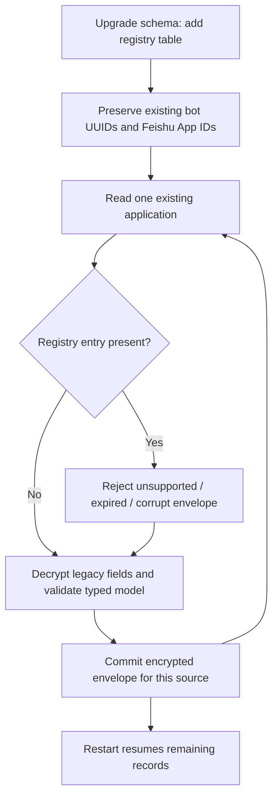

# Versioned messaging application credentials

[Issue #57](https://github.com/dynamicheart/lockbot/issues/57) introduces an additive registry for messaging credentials. It preserves existing bot, group route, platform user, binding, lock, queue and API credential identities. This is not a shared resource pool or a platform switch for an existing bot.

## Identity and ownership

| Provider | Stable application identity | Existing routing and ownership |
| --- | --- | --- |
| 如流 / Infoflow | Existing bot UUID | One application per resource bot; its webhook/Token/AES fields stay independent |
| 飞书 / Feishu | Existing external `app_id` | One enterprise application can serve several separately authorized group routes; original application integer IDs and route rows stay intact |

The `platform_applications` table contains `provider`, `stable_identity`, `name`, `schema_version`, Fernet `encrypted_payload`, `source_fingerprint`, optimistic `generation` and optional `expires_at`. The payload is validated against an explicit provider model. Schema 1 has exactly:

- Infoflow: provider, webhook URL, Token and AES key.
- Feishu: provider, App ID, App Secret, Verification Token and Encrypt Key.

Extra fields, wrong types, wrong providers and unsupported versions are rejected. There is no generic JSON credential write endpoint. Future providers require a new typed model, adapter and tests; adding a string to a platform dropdown does not authorize a new credential layout.

Payload encryption uses the existing deployment's Fernet key. The migration never rotates this key or application secrets. Keep the original `ENCRYPTION_KEY` and backup source key available through the existing secret-management process. No plaintext copy is introduced into a database column, audit event or migration log. The fingerprint hashes the legacy ciphertext fields, not their plaintext.

## Compatibility migration

Startup backfills one source per transaction. Re-running it is idempotent and does not rewrite unchanged records or original credential ciphertext. An interruption leaves earlier committed entries valid; missing registry entries use validated legacy fields until the next run. A corrupt source is reported by table and row ID only; other sources continue. It is not silently repaired or enabled.

For an existing registry entry, runtime resolution validates its schema, decryption, expiry, external identity and fingerprint. A bad entry never falls back to an old credential. A stale detached ORM object must be reloaded from its database session. Managed Infoflow callbacks check the current record before using a retained adapter. Existing provider adapter-extension and dry-run configuration inputs continue to work independently of this registry.

Provider writes mirror legacy fields and the encrypted envelope in the same SQL transaction. An encryption/validation failure rolls back both; optimistic generation rejects overlapping envelope edits. Existing Feishu rotation still verifies the application's bot identity, drains the receiver, checks current super-administrator authority, commits the new credential, invalidates retained clients and reconnects through the existing lifecycle controls. This refactor does not replace that flow with a generic setter.

Legacy columns and tables remain. Current writes keep them current, allowing rollback to a release that understands the same provider behavior and encryption key. **A rollback cannot understand a future schema/provider or new authority semantics.** After old code writes legacy credentials, the next upgrade explicitly reconciles supported schema-1 entries from those legacy fields during startup. Before reconciliation, layout disagreement is refused. Unsupported, corrupt or expired registry entries require administrator repair or a known-good backup; dropping the registry to evade such a failure is not a supported repair.

## Management API and permissions

`GET /api/admin/platform-applications` gives current super administrators a bounded metadata list, including the original provider management path. It does not return encrypted payloads, fingerprints or secret fragments.

- `POST /api/admin/platform-applications/{id}/reveal` explicitly reveals the validated typed payload. It commits an audit record first, then rechecks authority and generation. The response is `Cache-Control: no-store`.
- `PATCH /api/admin/platform-applications/{id}` accepts only `name` and `expected_generation`. A stale generation returns 409. Feishu names stay synchronized with their existing application; an Infoflow registry display label does not rename the resource bot.
- `DELETE /api/admin/platform-applications/{id}` removes only an orphaned registry record. An existing source blocks deletion. Use the original provider lifecycle API to delete an unused Feishu application; its existing route/in-flight/receiver guards remain in force.
- Credential creation and rotation continue through the existing provider-specific APIs advertised in `provider_management_path`, not through this metadata endpoint.

Each new management read of secret values, rename and orphan deletion is audited with actor, action, application ID, provider, schema and generation. No payload, secret or arbitrary request body is copied into that audit. Failed audit storage prevents disclosure.

This does **not** expand bot-owner access to enterprise application secrets or allow normal administrators into the registry. Existing Infoflow owners retain their existing ability to configure their own bot through the old typed bot API; removing that permission would break established clients and is outside this migration. Feishu application create/edit/reveal/rotation/delete remain current-super-administrator operations. Resource Agent keys, OP keys, `metrics:read` grants and `task_notes:read` audit grants are separate credential families and gain no messaging-application permissions.

## Backups and recovery

Whole-database backups naturally retain the encrypted registry table. Per-bot restore reads Infoflow entries by bot UUID and Feishu entries by external App ID, never an archived application integer ID. It carries encrypted schema evidence and an explicit nullable UTC expiry, and validates both before importing a source. Expired, missing or malformed versioned expiry evidence is rejected; a future expiry is copied unchanged into the destination registry instead of becoming unlimited. Legacy archives cannot clear an already-known target expiry. Unknown schemas, wrong providers, undecryptable envelopes and disagreement are rejected.

A Feishu application already present in the target is matched by App ID plus the existing tenant/bot-identity checks. Its current, possibly rotated secrets and expiry are preserved rather than replaced with an older archive. The target must itself pass current registry validation; an expired or corrupt target cannot be revived by selecting archive data. An expired source may be ignored only in this existing-Feishu-target case because its credentials are not imported. Infoflow overwrite actually imports source credentials, so it has no such exception. New applications are re-encrypted with the destination key and mirrored transactionally. Old archives without a registry remain importable through the validated legacy path. No display-name matching merges users or routes.

## Deployment and acceptance boundary

This is an application-code/database migration, not an enterprise-platform permission grant. It does not create, publish or approve an enterprise application. It does not change proxy settings, default message rendering, group membership or receiver transport. Follow the existing deployment guide with a database/state backup and the same encryption key; no extra service, dependency, network port or scheduler is required.

Tests cover interrupted/repeated backfill, preservation of legacy identities and ciphertext, provider-specific rejection, key continuity, atomic dual-write failure, optimistic conflicts, role changes during reveal, audit failure, typed backup validation, and existing Feishu route/rotation/restore behavior. Unit tests do not establish a live enterprise application's approval or real-platform connectivity. Production rollout still requires review and required CI on the accepted commit.
