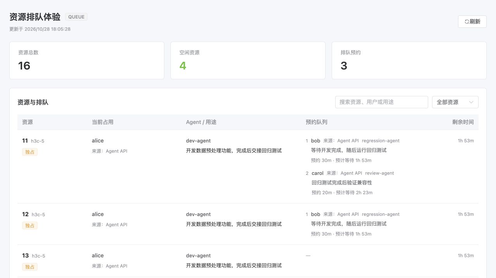

# 资源与排队网页

群成员需要快速查看谁在使用机器、谁在排队、各自准备做什么。网页沿用 Lockbot 的界面样式：先显示资源总数、空闲数和预约数，再用表格展示每个资源的占用人、Agent、用途、完整队列与剩余时间。手机上改为单列，队列默认展开。搜索可匹配资源、用户、Agent 和用途，也可筛选空闲、占用或有排队的资源。

管理后台和只读网页复用同一资源列表，避免两边展示方式逐渐分叉。用途文本可以查看，但不能在只读页编辑配置或执行资源命令。排队等待时间是按当前锁和前序预约计算的估计值；持有者提前释放、续租或取消预约都会改变它。

下图使用虚构用户和资源，演示默认可见的队列：

[查看手机布局](../images/resource-view-mobile.png)

## 如何取得链接

- 在对应群聊直接 @机器人，普通状态查询的回复会附上网页链接。
- Agent 使用自己的 key 调用现有 `GET /api/agent/context`，读取新增的可选字段 `view_url` 和 `view_expires_at`，把链接交给用户。
- 没有单独的 `web` 命令，也没有新的取链接接口。Agent 不需要向用户询问 bot ID。

链接形如 `/#/bot/1?view=...`。验证码保留在 `#` 后，便于刷新、收藏和转发；它不会随页面地址发给 HTTP 服务器。页面只把专用只读码放进状态请求的 Authorization 头，不使用个人 key、OP key 或管理后台的登录凭据，也不把只读码写入浏览器持久存储。

## 谁可以查看

每个链接只对应一个机器人，不提供匿名机器人目录。缺码、错码、过期、替换 bot ID 或 bot 已删除时，都不返回机器人及资源信息。页面只提示到对应群聊或已授权的 Agent 获取新链接。

这是可转发的只读链接。拿到链接的人可以在有效期内查看该机器人的资源、用户、队列和用途；它不代表对当前群成员身份的持续认证。撤销某个人的 key 会阻止他继续通过 context 获取链接，但不会单独撤销此前已经分享的群链接。链接不能执行个人、OP 或管理操作。页面不返回绑定编号和授权备注。

## 24 小时有效期

第一次通过群聊或 Agent 获取链接时，服务器创建查看窗口。从创建时起 24 小时内重复获取，返回相同链接和相同到期时间。过期后，下一次有权限的获取请求才生成新窗口；不需要每日定时刷新，也不按 UTC 零点换码。

网页刷新只校验和读取，不生成新码，也不续期。每次状态读取都由服务器检查当前窗口、bot 身份及到期时间。页面每 30 秒刷新一次，隐藏时暂停；到期或恢复可见时检查有效期，清除失效内容并提示重新取链接。普通整页刷新仍可以使用原链接。

## 存储与接口边界

独立的 `bot_view_windows` 表只保存每个 bot 的当前窗口：bot UUID、身份代际、随机数、创建时间和到期时间，不记录访问历史。签名绑定服务实例和上述字段。并发首次获取通过条件更新收敛到同一窗口，普通重启保留有效链接；bot 删除、身份变化或服务签名密钥更换会使旧链接失效。

`GET /api/bot-views/{bot_id}/state` 单独验证只读码，再读取运行实例的快照。快照可复用短缓存，授权检查每次执行；返回不可缓存的响应。入口也有限流，避免网页轮询占满资源。只有在请求通过验证后，才装配资源和用途信息。

原有个人和 OP API 的路径、凭据及权限不变。API 主版本仍为 1，context 只增加可选字段；旧客户端可继续忽略它们。数据库升级只新增表，回到不提供网页的版本时，旧代码可以忽略这张表，资源锁和队列的存储格式不变。

## 验收

- [x] 无效、过期、跨 bot 或其他类型凭据均不能读取资源；未知 bot 不额外泄露信息。
- [x] 首次生成、期内复用、精确到期、到期后更新、并发获取及窗口持久化已测试。
- [x] 签名群查询沿用群范围检查，返回的链接与个人 context 一致；查看码不能执行命令。
- [x] NODE、DEVICE、QUEUE 的持有者和用途可见；队列顺序和预计等待已验证。
- [x] 实际浏览器验证默认完整队列、搜索、筛选、链接刷新、后台共享列表和 390 像素手机布局。
- [x] 19 号机测试服务已部署；真实 API 创建 mock 用户占用与预约，原配置及绑定凭证保持不变。

验证环境使用虚构资源和测试 IM，未执行真实计算任务。正式上线以发布版本和部署记录为准。

页面以占用和排队为主：默认展示占用人、Agent 名称、队列顺序及时间。用途在悬停或键盘聚焦参与人时显示；手机可点按查看，避免长段用途挤占队列空间。
