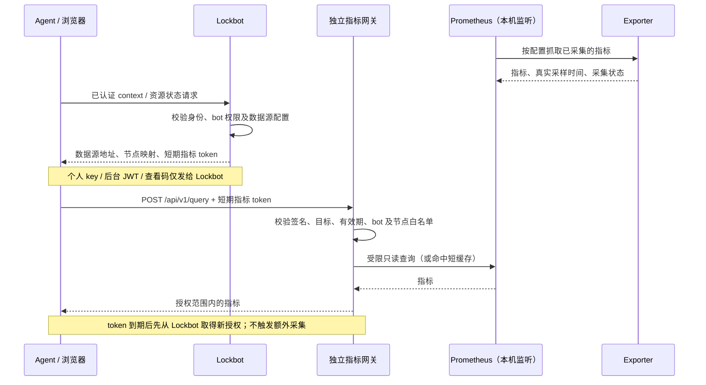

# 指标访问与授权边界

## 目标与职责

资源锁定和指标采集独立运行。Lockbot 不采集硬件指标、不保存时序数据，也不代理普通用户的指标查询。Prometheus 由数据源管理员维护，不需要安装 Lockbot 或理解 Lockbot 的用户系统。

普通用户和 Agent 的指标读取也需要授权，不能因为只读就公开容器、进程和主机信息。配套部署只向用户提供查询网关，Prometheus 监听服务器 loopback，不直接暴露给客户端。网关不提供写入、配置、管理或任意 PromQL 接口，只接受固定指标和已授权节点的查询。

| 组件 | 责任 |
| --- | --- |
| Lockbot | 验证个人 key、后台身份或资源网页查看码；可选地签发当前 bot 的短期指标授权 |
| 浏览器 / Agent | 直连配置的数据源，使用指标专用凭证；检查采集状态和真实采样时间 |
| 指标网关 | 独立校验签名、数据源 audience、issuer、bot UUID、节点范围和有效期；限制查询、限流及缓存 |
| Prometheus | 抓取 exporter、保存和查询时序数据；只接受本机网关等受控服务访问 |
| Exporter | 低频、错峰采集设备及主机信息；不因用户刷新而再次执行 SMI |

## 自动短期授权流程

网页使用自己的只读查看码访问资源状态；Agent 使用自己的个人 key 访问 `/api/agent/context`。两者都不把这些 Lockbot 凭证交给数据源。

### 为什么由 Lockbot 签发

这是数据源管理员显式配置的可选信任关系，不是 Prometheus 必须依赖 Lockbot。Lockbot 已经知道查看者是否有当前 bot 的资源查看权限，复用这次身份校验可避免用户再输入一份共享数据源密码。指标网关仍独立执行授权，且取 token 中节点与管理员为该 bot 配置的节点范围的约束，不能只相信前端过滤。

Lockbot 只签发访问声明，不位于指标查询的数据路径中。浏览器或 Agent 不能访问数据源时，指标不可用，但锁和队列不受影响。CORS 仅控制浏览器跨域行为，不替代网关认证，也不提供网络连通性。

第三方数据源可选择 `accessMode: independent`，自行提供认证，不信任 Lockbot 的签名。配套网关也保留管理员显式配置的独立只读 reader；这类凭证没有自动五分钟有效期，不能将其宣传成短期授权或作为普通查看者的默认共享凭证。自动授权模式 `short_lived` 是普通查看者免手工输入源凭证的推荐方式。

## 常见问题

### 1. 不带任何凭证访问 Prometheus，是否应该被拒绝？

是，普通用户读取指标也必须经过授权。需要区分两层入口：配套部署的 Prometheus 本体仅监听服务器 loopback，外部客户端无法直接连接；对外的指标网关拒绝匿名或无效凭证，返回 401。不能假定未经配置的裸 Prometheus 默认就要求认证，也不能将本机监听误认为 HTTP 认证。

网关只开放受限查询，不提供写入、配置或管理接口。Prometheus 本体的访问仍由服务器网络边界及主机权限保护，不能另行开放可绕过网关的入口。

### 2. Lockbot 和数据源解耦，Lockbot 怎么知道数据源凭证？

在自动短期授权模式下，Lockbot 不保存所谓的“Prometheus 登录密码”。管理员事先在 Lockbot 与指标网关配置同一份独立签名密钥，建立显式信任关系。Lockbot 根据已经验证的资源权限签发临时 token，网关验证签名、有效期和可查询节点；Prometheus 本身不识别这个 token。

因此，采集、时序存储和指标查询链路独立于 Lockbot；自动授权这一层有意复用 Lockbot 的身份和资源权限。第三方数据源仍可使用独立认证模式，无须接受 Lockbot 签发的 token。个人 key、OP key、后台 JWT 和网页查看码都不能作为数据源凭证发送。

### 3. 过期凭证如何处理？

短期 token 带有签名保护的有效期，网关每次查询都会检查，包括查询命中缓存时。最长有效期为 300 秒，按 30 秒窗口签发，并允许 15 秒时钟误差。过期后网关返回 401，客户端应在正常请求预算内重新从 Lockbot 获取授权，再查询数据源；领取失败则显示指标不可用，不能无限重试或改用其他凭证。

短期 token 仅在客户端内存保存。撤销个人 key 会阻止再次领取授权，但不会立即撤销已签发 token；紧急阻断须在网关撤销相应 bot 或 issuer。管理员显式配置的独立 reader 属于另一种认证方式，不自动具备上述短期有效期。

### 4. 用户浏览器直接访问数据源，指标会经过 Lockbot 服务器吗？

不会。客户端先向 Lockbot 获取配置及授权，再按 `浏览器 / Agent → 指标网关 → Prometheus` 的路径读取指标。Lockbot 不转发查询，也不接收查询返回的指标；客户端刷新指标不会触发 Lockbot 执行 SMI。

浏览器必须自行具备访问网关的网络路径，并满足数据源认证、CORS 和浏览器网络访问限制；Agent 也需要自己的可达路径及授权，但不受浏览器 CORS 机制约束。管理员浏览器验证成功不等于每个查看者都能访问。数据源访问失败只影响指标展示，不影响锁和排队。

## 当前实现与限制

- 使用独立 HS256 签名密钥，不复用个人 key、OP key 或后台 JWT 密钥。JWT 是签名而非加密，不应在声明中放秘密。
- 声明包含服务实例 `iss`、bot UUID `sub`、数据源地址 `aud`、允许的 `nodes`、`iat` 和 `exp`。只读能力由网关接口和查询白名单强制执行，响应的 `scope: metrics:read` 用于说明用途。
- 签发时按 30 秒窗口对齐，最长 300 秒，因此通常剩余约 270～300 秒；不晚于签发所依赖的个人凭证或网页码期限。网关允许 15 秒时钟误差。
- 授权范围目前是 **bot 的已映射节点**，不是进程所属用户，也不是单张卡。按卡机器人不可据此声称同一主机上的其他卡或容器已被隔离。
- 客户端仅在内存保留短期 token，按正常 API 预算重新获取；不能把它保存成长期个人 key，也不能在失败后尝试其他 bot 的凭证。
- 个人 key 撤销后不能再领取新 token，但已签发 token 仍可使用到期。紧急阻断应在网关撤销 bot / issuer 范围；关闭网页或删除前端配置不等于立即撤销已有 token。
- 多数据源可由部署管理员配置 `METRICS_GRANT_SIGNERS_FILE`：按规范化数据源 audience 选择独立密钥，配置文件和各密钥文件使用绝对路径与 0600 权限；不把密钥放进数据库、用户表单或客户端。已设置该变量但配置无效、为空或数据源未登记时拒绝签发，不回退共享密钥。未设置该变量时保留单文件 `METRICS_GRANT_SECRET_FILE` 兼容模式，不宣称旧部署已经自动迁移。
- HS256 验证端掌握同一签名密钥，也具备签发能力。不同信任域应使用不同密钥，网关仍独立维护 issuer、bot UUID 和节点范围；不能只依赖 token 的 audience 或前端映射。相同密钥、重复 audience/文件等注册表错误会拒绝整个配置；密钥轮换影响后续签发，已签发 token 仍受原网关验签策略和最长有效期约束。非对称验签不是当前实现。
- 授权不提供传输加密。正式入口应部署 HTTPS；裸 HTTP 上的 Bearer token 存在被网络中间方读取及重放的风险，短期有效不能替代 TLS。

## 部署验收

检查 Prometheus 仅绑定 loopback、网关不转发管理或写入接口。匿名或错误凭证应拒绝，过期 token 应拒绝，越界节点应拒绝；合法用户只得到配置范围内的数据。分别验证浏览器和 Agent 的实际网络路径，不能把管理员浏览器的一次连接成功视作所有用户可达。

使用方法见 [浏览器利用率](../usage/browser-utilization.md)，独立部署与密钥配置见 [部署包说明](../usage/telemetry-deployment.md)。
