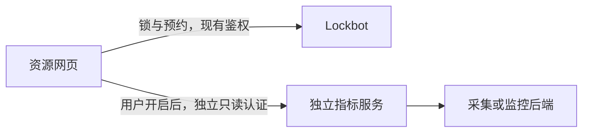

# 网页利用率集成：调研与第一版建议

状态：设计草案，未实现、未修改部署。核对日期：2026-10-28。

建议先做“网页可选加载指标”，把采集留在独立指标服务。Lockbot 继续负责锁、队列、用途和权限；指标失败不能拖慢这些功能，更不能据此自动释放资源。第一版不建立全平台统一机器池，不扫描所有机器人。

## 参考实现的取舍

参考实现由 Lockbot 服务端通过 SSH 执行设备采集，有共享刷新线程池、缓存、后台轮询，并关联空闲统计及自动释放。它不是纯浏览器插件。可以借鉴批量查询、同目标请求合并和慢节点降级；本方案不移植 SSH、全局轮询、进程/容器探测、空闲释放或匿名全 bot 目录。

## 第一版的使用方式

1. bot 管理人在编辑页选择一个平台允许的指标提供方，配置该 bot 的资源映射。不是每个访问者自己填任意 URL。
2. 网页先正常显示锁和预约队列。仅当该 bot 已配置提供方时出现“显示利用率”，由当前访问者自主打开。
3. 打开后，内置渲染组件从提供方获取纯 JSON，并将指标叠加到现有资源行。不开启不请求；离开、切换 bot 或页面隐藏时停止轮询；返回可见时最多补一轮。
4. 默认只显示计算利用率、显存占用及采样时间；用途仍按现有 hover 方式展示。未知值显示 `—`，失败显示“暂不可用”，过期值明确显示“数据已过期”。不把失败/缺项当作 0%。
5. “锁空闲”和“设备利用率低”是两件事，两个维度分开。指标不证明任务归属，不改变队列，不触发自动释放或杀进程。

“插件”在第一版是可信内置的指标适配器和渲染组件，加上配置，不是从用户 URL 下载并执行 JavaScript。第三方 JS 在 Lockbot 页面里执行可能读到页面资源、只读码或客户端凭据；若以后需要真正第三方代码，再独立讨论隔离 iframe 和最小 postMessage 协议。



指标链路慢或不可用，锁和排队链路仍可独立工作。需要同源入口时，把指标请求反向代理到独立网关，不改成 Lockbot 主进程逐卡采集。

## 请求走哪条路

| 方式 | 优点 | 条件及代价 |
| --- | --- | --- |
| 浏览器直接访问指标服务（优先评估） | 指标带宽、轮询和采集不经过 Lockbot 服务；改动少 | 用户浏览器能访问该地址；提供方支持 CORS、HTTPS 和自己的认证、按资源授权 |
| 同源独立指标网关（推荐的兼容后备） | 浏览器请求同源 `/metrics/...`，反向代理转给独立进程，不受普通跨域问题影响 | 需要配置入口反向代理；网关自己处理提供方认证、映射、缓存和限流；其故障不影响 Lockbot 路由 |
| Lockbot 后端内置代理（不作为默认第一版） | 部署入口单一，易复用 bot 权限 | 承担指标请求连接、带宽、鉴权和 SSRF 风险；必须有独立并发预算、超时、响应体上限、缓存和熔断，绝不能把浏览器 URL 直接转成服务端请求 |

服务端转发避开浏览器 CORS，但并不免费。独立网关把昂贵工作从 Lockbot 进程分离出去；不是简单把 SSH 移到 FastAPI 的一个路由里。

目前指标服务尚未设计，不能保证浏览器直连一定可行。先把纯 JSON 协议和页面做好，用 fake provider 验证，再根据实际网络和认证选直连或网关，不先造完整插件平台。

## 权限和跨域的边界

- Lockbot 的个人 key、OP key、管理 JWT、网页只读码都不发给指标提供方，也不写进其 URL 或日志。提供方和 Lockbot 的认证互相独立。
- 第一版优先使用提供方已有的登录/短期只读认证。提供方必须自己校验用户能看哪些资源；CORS 只控制浏览器是否能读取响应，不是数据权限。不能因“能打开 Lockbot 网页”就把上游全库查询权限交给浏览器。
- bot 管理员的映射限定页面合并范围，提供方也必须按其认证范围过滤；客户端发来的 resource_id 不是授权证明。不得提供匿名全局资源枚举来方便映射。
- 如果独立认证体验不合适，再增加可选的短期 `metrics.read` 授权交换：只对平台管理员允许的提供方签发，限定 audience、bot UUID、资源集合、有效期，不复用现有 key；到期/撤销语义需单独确定。第一版不引入新的 OAuth 系统。
- 浏览器直连需精确配置允许的页面 origin（协议、主机、端口均有关），支持所需 `OPTIONS` 预检；跨域 cookies 还需适当的 credential 配置，不能用 `Access-Control-Allow-Origin: *` 配合 credential 模式。不要把浏览器报错等同服务端未收到请求。
- HTTPS 网页访问 HTTP 指标接口通常会遇到 mixed-content 限制；现代 Chrome 对公网页面访问本地网络还有 Local Network Access 权限约束。局域网访问、Chrome 的特例、不同浏览器行为都需要真机验证，不能靠“加一个 CORS header”承诺可用，也不让用户关闭浏览器保护。
- 若服务端代理需要访问内网指标地址，只允许管理员配置的精确主机/端口或专用网段；禁止用户覆盖目标，禁重定向，限制协议，校验 DNS 解析与实际连接目标，排除云元数据、loopback、link-local 等未授权目标。只读页访问者不具备配置上游 URL/请求头的权限。

官方参考：[MDN CORS](https://developer.mozilla.org/en-US/docs/Web/HTTP/Guides/CORS)、[MDN Mixed content](https://developer.mozilla.org/en-US/docs/Web/Security/Defenses/Mixed_content)、[Chrome Local Network Access](https://developer.chrome.com/blog/local-network-access)。以上是浏览器约束；实际企业网络是否可达仍需测试。

## 最小指标协议（建议，尚不是已发布 API）

提供方暴露一个版本化只读批量接口即可。不要让浏览器提交 PromQL、SQL、shell、IP 或任意 URL。

```json
{
  "schema_version": 1,
  "captured_at": "2026-10-28T15:00:00Z",
  "next_poll_seconds": 30,
  "items": [
    {
      "resource_id": "node-a:dev0",
      "device_uid": "gpu-stable-id-001",
      "observed_at": "2026-10-28T14:59:58Z",
      "valid_for_seconds": 90,
      "status": "ok",
      "compute_utilization_percent": 63.5,
      "memory_used_bytes": 17179869184,
      "memory_total_bytes": 34359738368
    }
  ]
}
```

- `resource_id` 是映射后的 Lockbot 资源标识；提供方原始 machine/device ID 在受控配置中映射，不能按名称相同、卡型号相同或数组位置猜测。多服务用 `(origin, instance_id, bot_uuid, resource_id)` 区分，bot 数字 ID 不是全球唯一。
- `device_uid` 优先使用提供方稳定设备 ID；逻辑 dev0 与物理卡可能因重启/配置变化而不同。映射变化后旧样本失效，无法映射显示未知，不把前一张卡的指标挪到后一张。
- 数值单位固定，0 和 null/缺项严格区分；利用率需 finite 且在 0–100，字节值非负、total 大于 0。支持部分成功，单卡失败不能让整页报错。响应限制条数和总大小。
- 请求只包含当前 bot 授权资源、按批次查询。采样时间和页面收到时间分开，过期计算扣除请求耗时；提供方时钟偏差不能让旧值永久有效。
- NODE/QUEUE 整机指标可以作为明确标注的汇总显示，不用机器平均值代替每卡数值。DEVICE/QUEUE_DEVICE 必须匹配精确卡。
- 默认不取进程名、命令行、容器名、完整任务标题和用户名。性能指标不应成为另一条敏感信息披露通道。

## 控流与压力

第一版建议每个启用页面每 30 秒一轮批量请求，初始随机错峰；提供方返回更慢间隔或 `Retry-After` 时服从。每页仅一个进行中的请求；超时先取消，有限退避，不堆积补发。提供方批量限制可从 128 个资源/请求、1 MiB 响应、3–5 秒超时起步，依据真实规模验证后再定，不把草案数值写成现有能力。

100 个页面每 30 秒批量读一次约 3.3 请求/秒，而不是“100 人 × 每张卡一次”。提供方/独立网关再按 `(provider, tenant, bot scope, mapping revision)` 合并同一份采样，最多每个缓存期采集一次。缓存不能跨越授权范围；失效后给明确 stale 标记和有限保留，不能无限展示旧值。必要时限制单 bot、单用户和全局并发；按钮刷新也服从服务端缓存与预算。

协议适配器不进入核心锁状态锁，不让慢指标占用命令执行队列。无页面开启时，Lockbot 不触发后台全量采集；提供方自己是否持续采样由其服务负责。必须实测故障时锁/释放/队列接口延迟，而不是宣称“零性能影响”。

## 分步验收

1. 用 fake provider 验证字段、部分失败、未知/0、时间过期、乱序卡 ID、越权资源过滤及超大响应，网页不影响原队列。
2. 验证开关、页面隐藏、重连、取消请求、退避和多个标签页，不产生请求风暴。
3. Chrome 和另一主流浏览器测试直连的 CORS、预检、HTTPS/HTTP、局域网权限及认证；不可用时验证同源独立网关方案。
4. 指标服务超时/429/500/慢连接时，测量 Lockbot 原命令和网页状态请求延迟；跨 bot 不串数据，不把失败显示空闲。
5. 接真实指标服务，验证物理设备映射和采样语义，然后在 19/fake bot 试用。正式机器人不改类型、状态或资源所有权。

待确认的只有实际提供方地址/协议、网络可达性、认证与租户权限、稳定设备 ID 和采样频率。其余可以先用假服务完成协议与 UI 原型；无需等接口设计完才开始页面验证。
