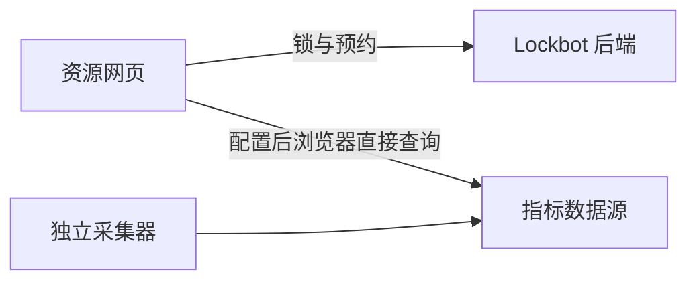

# 网页利用率数据源插件（第一版设计）

状态：2026-10-29 方案收敛；实现单独 PR，真实指标源尚未确定。参考实现的只读调研记录另存开发工作区，不把其完整采集系统移植进来。

## 边界

Lockbot 后端只管理非敏感的数据源配置，不采集、不代理、不保存指标，也不根据利用率执行资源操作。外部采集器和指标数据源负责采样、历史存储、认证、授权及 CORS；Prometheus 是第一种支持的数据源，不是运行 Lockbot 的前提。

网页先正常显示锁和队列。管理员为该机器人配置数据源后，浏览器独立查询并展示指标；未配置时不显示利用率，也不发指标请求。失败只影响指标展示，不影响 Lockbot 状态刷新和资源操作。低利用率不代表资源可用，不触发自动释放、续期、抢占或杀进程。



第一版只包含逐卡计算利用率、显存已用/总量、真实采样时间、异常状态及简单的数据源配置。容器/进程信息、固件详情、连续空闲统计、历史曲线和自动化控制不在首版范围。

## 借鉴 Grafana 的数据源模式

借鉴职责划分，不复制完整 Grafana 插件平台：

| 部分 | 职责 |
| --- | --- |
| 数据源配置实例 | 类型、名称、地址、查询/标签映射及非敏感设置 |
| 配置界面 | 添加/选择数据源，测试连接，检查查询与设备映射，选择是否启用 |
| 内置适配器 | 实现查询与连接测试，将不同数据源结果转成统一页面快照 |
| 资源展示组件 | 接受统一数据，显示指标、未知、过期和错误；不拼 PromQL |

首版只注册可信的 Prometheus 内置适配器。后续增加数据源时扩展适配器，不改锁和队列组件。内部 `query`、`testDatasource` 边界不等于已经发布第三方插件 SDK，也不要求实现通用查询编辑器。

首版每个机器人配置一个 Prometheus 数据源，由机器人所有者或管理员在编辑页测试并保存。非敏感地址、查询与资源映射保存在可空的 `bots.utilization_config` 字段；升级增量添加该列，旧客户端未传该字段时保留现值，显式 null 表示清除。查看接口仅在通过机器人查看权限校验后返回配置。切换服务、bot 或数据源必须清除旧指标，不凭相同机器名自动复用另一机器人的映射。数据源凭证仅在当前浏览器内存中使用，不随配置分享、持久化或备份。

“测试连接”应从当前浏览器验证相关查询及返回格式，不能只在后端测连通性或检查 `/health`。不自动扫描内网寻找数据源，不读取全 Prometheus 指标目录来猜资源。

Grafana 自身包含后端及代理型插件，这不意味着本方案也使用代理。这里只借鉴配置、查询、测试和展示的分离。

## Prometheus 协议与页面格式

复用稳定的 Prometheus HTTP API；不要求另造一个指标服务 HTTP 协议。当前值使用 `/api/v1/query`；未来历史曲线可用 `/api/v1/query_range`。采集器可使用 Prometheus/OpenMetrics 暴露格式；这些采集协议与浏览器查询 API 是不同层。

适配器负责把实际指标名、标签与单位转成小型内部格式，例如：

```json
{
  "schema_version": 1,
  "items": [{
    "resource_id": "node-a:dev0",
    "device_uid": "device-001",
    "observed_at": "2026-10-29T00:00:00Z",
    "status": "ok",
    "utilization_percent": 72,
    "memory_used_bytes": 17179869184,
    "memory_total_bytes": 34359738368
  }]
}
```

- 使用明确的机器/设备标签映射；不按数组位置、型号或同名猜物理设备。不认识的设备保持未知，多卡不能平均成一个数掩盖忙卡。
- 提供常见指标与查询模板，简单使用不要求每个人手写 PromQL；自定义指标映射可以进入高级配置。模板只是适配约定，不强迫采集服务使用 Lockbot 专属指标名。
- 利用率必须有限且在 0–100，字节值非负且容量有效。Prometheus 中的字符串数值、NaN/Inf 和缺失结果需要明确处理；缺失不能转成 0。
- Prometheus instant vector 的求值时间不一定是底层采样时间。通过明确的源采样时间查询或相应协议取得真实时间，不能用网页刷新时间伪装新鲜值。
- 区分 0、未知、采集失败、数据过期；过期快照有限保留并明确标注，数据源切换时清除旧值。页面不保存原始长期采样序列。
- 默认不查询容器、进程、任务标题或用户名，避免形成新的敏感信息披露通道。

## 浏览器、认证和跨域

指标请求使用独立客户端，不复用携带管理 JWT 的 Lockbot API 客户端。绝不向指标源发送 Lockbot 个人 key、OP key、管理凭据或网页只读码；源凭证不放 URL、日志或浏览器持久存储。使用数据源自身支持的认证；第一版不建设凭证交换或 OAuth 系统。

数据源需按实际网页 origin 配置 CORS，必要时支持 OPTIONS 和认证头。裸 IP 也有协议、主机、端口的同源要求。HTTPS 页面访问 HTTP 数据源可能被混合内容策略拦截，浏览器还可能限制本地网络访问；使用者的浏览器必须实际可达。连接测试给出简洁故障提示，不关闭浏览器保护、不使用 `no-cors` 假装解决。

CORS 不是权限系统，前端的 bot/资源过滤也不是数据源 ACL。若不能让用户查看整个指标库，数据源自身必须提供相应授权范围；不向浏览器下发拥有全库权限的共享秘密。旧数据源不支持 CORS 时应在数据源侧解决，不回退为 Lockbot 后端代理。

内置适配器处理纯数据，不从用户 URL 下载并执行远程 JavaScript。若以后确需第三方代码，再单独评审隔离方式，不让其直接读取页面和管理凭据。

## 刷新和展示

每页约 30 秒或更慢一轮，当前实现每轮最多 6 个批量查询、并发上限 2，不按每张卡各发请求。100 个持续打开的页面平均约产生 20 请求/秒，压力由独立指标源承担；管理员仍需按实际访问规模配置源侧限流。每页只有一个进行中的刷新，配置超时、有限退避、返回大小/序列数限制；服从上游 429 和 Retry-After。手动刷新也服从节流，不堆积补发。

页面隐藏、离开、关闭插件或 bot 查看权限失效时取消请求。恢复可见时最多补一轮；跨 bot 切换清除旧内容。Prometheus 采样是否继续由外部服务管理，不依赖网页是否打开。

队列仍是主要信息，只在配置了数据源时增加紧凑指标展示。利用率低于 30% 用绿色、30%–79% 用琥珀色、80% 及以上用红色；未知或过期用灰色。颜色只表达指标区间，不代表锁是否可用。型号、用途、状态和指标各自保留语义，手机布局不让指标挤掉队列。

## 验收

1. 本地 fake Prometheus 覆盖正常、空数据、0、异常数值、部分失败、过期、乱序/重复设备和错误映射。
2. 浏览器验证 CORS、预检、认证失败、超时、429、超大响应及数据源切换，证明不携带 Lockbot 凭据。
3. 验证开启/关闭、隐藏、离开、查看码失效、重连与手动刷新，不产生请求风暴。
4. 桌面和 390px 手机浏览器验证布局；指标服务故障时仍能查看锁和队列。
5. 真实数据源待确定后，再验证指标语义、稳定设备身份、权限和采样时间。fake 验收不能声称真实设备采集已完成。

## 参考

- [Grafana 数据源插件](https://grafana.com/developers/plugin-tools/tutorials/build-a-data-source-plugin)
- [Grafana 插件组成](https://grafana.com/developers/plugin-tools/key-concepts/anatomy-of-a-plugin)
- [Prometheus HTTP API](https://prometheus.io/docs/prometheus/latest/querying/api/)
- [Prometheus 安全模型](https://prometheus.io/docs/operating/security/)
- [MDN CORS](https://developer.mozilla.org/en-US/docs/Web/HTTP/Guides/CORS)
- [MDN Mixed content](https://developer.mozilla.org/en-US/docs/Web/Security/Defenses/Mixed_content)
- [Chrome Local Network Access](https://developer.chrome.com/blog/local-network-access)
