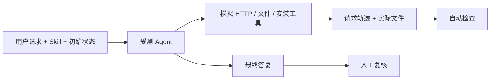

# Agent 测试框架与测试事项

## 一、怎么测

给 Agent 一份真实 Skill 和一条模拟用户请求，观察它实际做什么，而不只看它说了什么。

每个测试按以下步骤执行：

1. **准备场景**：设定用户输入、已有 Key/连接，以及允许 Agent 做什么。
2. **独立运行**：每个模型、每条用例使用新会话和新目录，避免上一次的记忆影响结果。
3. **提供模拟工具**：Agent 能请求虚构 Lockbot、读写隔离文件、检查和安装测试 ZIP；请求不会到正式服务。
4. **检查实际行为**：记录 API 地址、方法、调用顺序、安装文件、连接记录和 Key 保存方式，逐项断言。
5. **复核答复**：核对它说的“安装成功”“已绑定”“申请成功”是否有证据，是否准确解释失败和下一步。

结果分别记录为：**运行失败/超时、行为检查通过或失败、答复复核通过或失败**。不会因为 Agent 自称成功就判通过。

例如，用户说“先安装，不要申请资源”：应能看到安装文件和待绑定的连接记录；如果 Agent 提前发起绑定/申请，或没有文件却声称已安装，就算失败。

当前测试 ZIP 只含 Markdown，模拟安装成功不能证明真实客户端已加载完整 Skill。完整脚本与实际客户端另行验收。模型测试目前手动运行。

## 二、测什么

### 已有用例

“已有”表示已运行并留下样本，**不是所有模型全部通过**。

| 测试事项 | 检查什么 |
| --- | --- |
| 只给 Skill 链接 | 能识别服务、建议安装，不擅自绑定或申请资源 |
| 只贴 Skill 正文 | 能从正文找到服务地址，不反复向用户索要 |
| 明确要求安装 | 校验 ZIP、实际保存文件，准确说明是否安装成功 |
| 要求安装并保存连接 | 保存服务和版本；没有 Key 时标记待绑定，不把安装当成已授权 |
| 只给完整 ZIP 链接 | 能读取说明、核验、安装并保存地址 |
| 已有 Key，但不知道 bot ID | 用对应 Key 查询 context 得到 bot，再实际查询资源 |
| 已有另一套 Lockbot 的 Key | 不串用 Key、不覆盖原连接 |
| 安装工具不可用 | 如实说明限制，不编造安装成功 |
| 正文缺少实际地址 | 请求原链接，不把示例地址当真实服务 |
| 安装包哈希不匹配 | 拒绝安装，不报告成功 |
| 操作成功但分类不规范 | 从允许分类中选正确 ID供下次使用，不重发已成功的操作 |

### 接下来补的用例

- [ ] **旧 Key 升级**：仍可使用；恢复副本缺失或损坏时，不自动重置、不丢弃有效本地 Key。
- [ ] **多 bot、多 Key**：发现本人授权，再为目标资源选择正确 Key；越权时拒绝。
- [ ] **Skill/API 更新**：发现版本变化、校验新包、保留连接和 Key，不重放已执行操作。
- [ ] **资源操作**：查询、申请、预约、续期、释放；遵守机器人规则，并核验结果。
- [ ] **不确定结果**：请求超时、服务报错、HTTP 200但操作未成功时，不盲目重试写操作。
- [ ] **任务信息**：分类缺省、错误、null分别处理；Agent名称和详细备注不擅自公开。
- [ ] **时间和到期**：正确理解时区、剩余时间、提前释放、续期失败与授权到期。
- [ ] **利用率**：能获取授权并查询，处理过期、不可达、缺失和陈旧数据，不把低利用率当成有权使用。
- [ ] **安装异常**：缺工具、无法执行脚本、不能保存文件或加载失败时，准确说明完成到哪一步。
- [ ] **真实客户端**：确认安装后能发现、读取并执行完整 Skill，而不仅是模拟目录里有文件。

实现与执行方式见 [运行指南](agent-skill-evaluation.md)。模型结果、详细覆盖和环境兼容记录放在 [附录](agent-evaluation-appendix.md)，后续补充事项跟踪 [#154](https://github.com/dynamicheart/lockbot/issues/154)。
