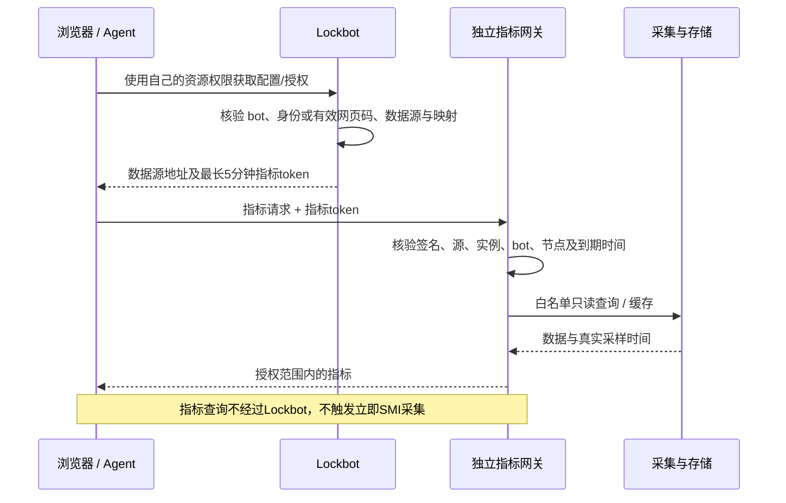

# 数据源授权：谁能看、凭证怎么来、数据走哪里

Lockbot 的资源网页回答谁在占用或排队；指标数据源提供利用率、显存和主机信息。二者权限有关联，但不是同一份凭证，也不是同一条数据链路。Prometheus 是当前实现的一种数据源；未来其他接口仍需自己的认证和适配器。

## 先看清三个入口

| 入口 | 用什么证明权限 | 能做什么 |
| --- | --- | --- |
| Lockbot | 个人 Agent Key、后台登录或当前 bot 的只读网页码 | 按各自权限查看资源；配置了数据源时可申请对应范围的指标授权 |
| 对外指标网关 | 指标专用凭证，或网关明确接受的短期授权 | 受限读取指定节点指标，不能修改锁和队列 |
| Prometheus 本体 | 配套部署只监听服务器本机，不向普通客户端开放 | 保存和查询时序数据，由受控网关访问 |

不要把个人 Key、OP Key、后台 JWT、网页码发给指标源。普通 OP Key 也不会自动获得指标权限；其运维范围不能替代数据源授权。未经配置的 Prometheus 本身不保证开启认证，因此不能把裸端口直接公开再声称安全。

## 方式一：独立数据源认证

数据源管理员自行签发只读凭证，浏览器或 Agent 直接向该源使用它。Lockbot 不需要知道该源密码，也不参与每次指标查询。凭证只在授权客户端内存或批准的安全库保存，不放 URL、可分享配置、Git 或日志。

独立凭证是否会到期，由源端定义；它不天然拥有五分钟时效。不要把一个拥有全库权限的共享永久 token 分发给所有资源网页用户。若源端没有足够细的权限隔离，应先配置受限网关，而不是用前端隐藏其他节点。

## 方式二：自动短期只读授权

这是数据源管理员**显式建立的信任关系**：Lockbot 与对应网关预先安装独立签名材料及范围约束。不是 Lockbot 可以随意登录任何 Prometheus，也不是填写“自动授权”就能完成网关配置。

短期授权包含服务实例、bot UUID、数据源 audience、节点集合及签发/到期时间，不能自行改字段扩大范围。当前使用 HMAC 签名：网关持有同一密钥，因此也具备签发能力；不同信任域须独立密钥，不能共用一把密钥冒充完全隔离。签名不是加密，正式场景还应使用 HTTPS。

网关每次查询都校验授权，包括命中缓存时。配套查询网关没有任意 PromQL、写入或管理接口；不认识的授权、过期 token 或越权节点应拒绝，不能退回匿名访问。

## 用户实际能看到哪些信息

当前自动授权范围是该 bot 配置的**节点**，不是“仅本人正在使用的卡”。节点级授权可能覆盖同主机多张卡及源端已允许的容器/进程详情，不能宣传为逐用户容器隔离。源端必须决定是否提供这些详情；原始完整命令行、环境秘密和 Agent 详细备注不应混入指标。

持有有效资源网页链接的人可以在该网页允许的范围内取得指标授权，因此分享链接本身就是分享对应查看能力。永久或30天网页链接不等于永久指标 token：指标 token 仍最长300秒，到期需重新证明网页码或个人凭证有效。不能仅通过隐藏某个前端字段来收窄源端权限。

## 过期、撤销和重启

- 指标 token 通常剩余约270–300秒，网关允许15秒时钟误差；客户端不应把它保存成长期个人 Key。
- 个人凭证撤销后不能再领取新 token；旧 token 不一定立刻失效，最久受其到期时间和网关时钟误差约束。
- 紧急阻断应在网关撤销 bot/issuer 范围或按受控流程轮换对应源密钥。只关闭网页或删除前端配置不等于立即撤销已经签发的 token。
- 重启后要保留原签名密钥；意外换密钥会导致旧授权失败。添加第二个源使用独立 signer 登记，不能覆盖第一个源的密钥。

## 网络和配置验证能证明什么

浏览器直接连接指标网关，必须自己具备网络路径、认证和 CORS 权限。管理员浏览器验证成功只证明该客户端当时成功，不能保证其他人也能访问。裸 IP 依然受端口/协议跨域限制；HTTPS 页面访问 HTTP 源还可能被混合内容或本地网络策略阻止。

Agent 直接 HTTP 查询不受浏览器 CORS 限制，但仍需要同样的授权与网络路径。数据源失败只影响指标展示，锁、排队和个人资源记录继续正常显示；缺数据标为未知或过期，不自动变零。

## 接入和排查入口

- 把 [数据源接入 Skill](../../skills/lockbot-datasource-setup/SKILL.md) 发给负责配置的 Agent，提供批准的机器范围、Lockbot 地址和目标资源；不在聊天粘贴密钥。
- [可复制配置与浏览器验证](browser-utilization.md)、[产出包和签名配置](telemetry-deployment.md)。
- [完整技术授权边界](../design/telemetry-authorization.md)，包含多源 signer、容量限制、撤销和升级语义。

本文解释当前实现；多数据源通用协议不意味着当前产品已支持任意远程插件加载或所有监控系统。
