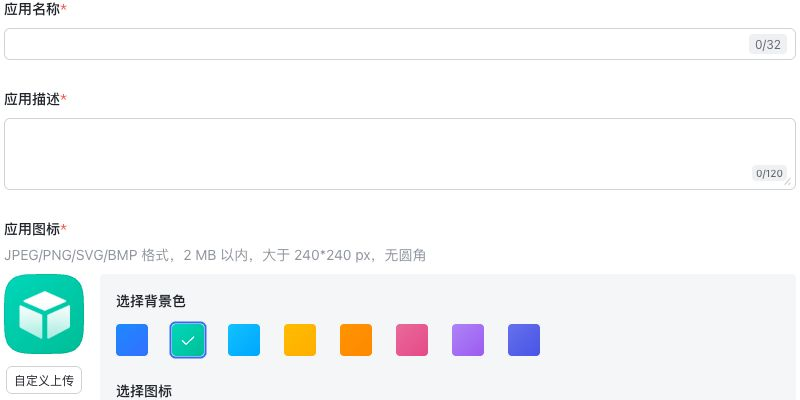
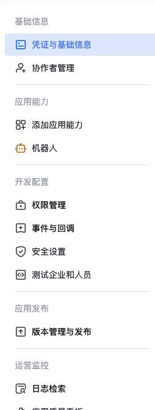
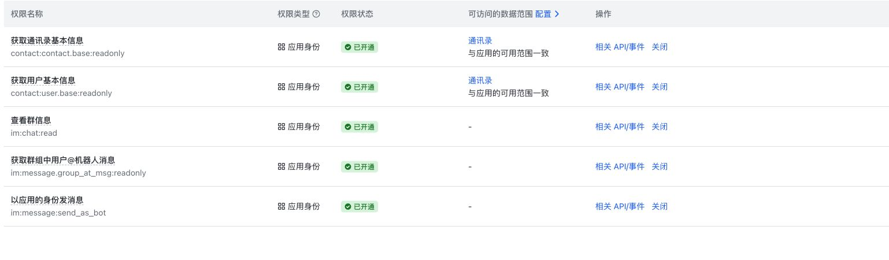

# 飞书接入图文指南

本指南面向企业管理员与 Lockbot 超级管理员，使用一个企业自建应用服务多个资源群，每群独立管理资源。如流继续保留。截图来自 2026-10-29 飞书官方开发者后台的只读查看，原生裁切后排除了企业名称、人员、App ID、凭据及地址栏；不是在本轮重新创建、申请权限或发布应用的流程录像。飞书控制台可能更新，以实际页面与企业审批规则为准。

更完整的协议与权限说明见 [飞书部署说明](feishu.md)。本指南适用于 Lockbot 3.0.0 及后续版本。飞书应用自身的版本号与 Lockbot 软件版本独立；企业审批、应用发布和实际部署分别核对。

## 1. 创建企业自建应用并启用机器人

进入[飞书开发者后台](https://open.feishu.cn/app)，选择正确企业，再选“创建企业自建应用”。填写应用名称、描述、图标；不要误选会预置额外权限的其他应用模板。已有合适应用可直接复用，无需重复创建。

图中只是空白表单示例，拍摄后已取消，没有创建新应用。

应用内进入“添加应用能力”，添加机器人能力。后续分别使用以下菜单：凭证与基础信息、权限管理、事件与回调、版本管理与发布。

在“凭证与基础信息”取得 App ID 和 App Secret，交给本站超级管理员配置。不要把 App Secret 发到群里、写进公开 Issue、截图或 Agent 的公开笔记。这里没有截取实际凭据区域，示例不提供真实 App ID、Secret 或企业专用地址。

## 2. 配置权限与数据范围

完整的姓名、群名管理使用以下五项应用身份权限。核心群命令的接收与发送是前两项；其余用于群名及姓名展示。

| 权限 | 用途 |
| --- | --- |
| `im:message.group_at_msg:readonly` | 接收群内真实 @机器人的消息 |
| `im:message:send_as_bot` | 发送回复与资源提醒 |
| `im:chat:read` | 读取已选群的名称等基本信息 |
| `contact:contact.base:readonly` | 调用获取用户信息接口 |
| `contact:user.base:readonly` | 读取 name 等用户基本信息字段 |

两项联系人权限互补，不是宽窄替代。[官方获取用户信息接口](https://open.feishu.cn/document/uAjLw4CM/ukTMukTMukTM/reference/contact-v3/user/get)分别列出 API 调用权限与字段权限。它们仍受应用可用范围和数据范围限制；无需手机号、邮箱、群成员遍历或所有群消息权限。没有可用姓名或缓存时，Lockbot 的文本、网页、API 回退稳定 Open ID；原生 @ 由飞书客户端解析平台名，不据姓名鉴权。

Lockbot 不支持单聊资源操作，不申请 `im:message.p2p_msg:readonly`。本次示例应用已关闭该项，当前控制台确认修改均已发布；不要因为调试需要重新加上。

“免审权限”和“功能需要哪些权限”是两个维度。上述权限在本次测试企业曾标为免审，但不保证其他企业或未来规则相同。免审也不代表免应用发布、免企业管理员批准或自动扩大可用成员范围。

## 3. 在本站添加企业应用与网络配置

超级管理员进入“站点设置 → 消息平台 → 飞书应用”，添加应用：

| 字段 | 填写方式 |
| --- | --- |
| 应用名称 | 本站辨识用的名称，不会修改飞书机器人名称 |
| App ID / App Secret | 从官方“凭证与基础信息”复制；Secret 使用密码输入并加密保存 |
| 接收方式 | 优先长连接；只需服务主动出站，不需公网入站地址 |
| Verification Token / Encrypt Key | 长连接不填；仅 HTTP 回调模式使用相应事件校验/加密配置 |

字段问号提供简要说明，弹窗“接入说明”返回部署文档。保存后列表不显示 Secret 明文。应用管理仅超级管理员可用。

同组的“飞书专用代理”可选择：

- 跟随部署配置：默认兼容 `LOCKBOT_FEISHU_PROXY_URL`。
- 直连：飞书 HTTP 与 WebSocket 显式直连。
- 指定代理：使用不含用户名、密码、路径或查询参数的 HTTP(S) 代理地址。

代理仅影响飞书，不改变如流或指标数据源。修改有效策略后先停止旧接收端再连接；保存或 HTTP 测试成功，不等于 WebSocket 已握手。企业出口仍应遵守网络管理规则，不关闭 TLS 校验。

## 4. 接入长连接并订阅消息事件

在本站应用列表启动连接任务，确保当前企业应用只有一个接收端；先停掉其他本地/测试服务，避免多个进程争抢同一应用的事件。

在官方后台“事件与回调 → 事件配置”选择使用长连接接收事件。服务器 SDK 连接成功后，再按控制台要求验证、保存配置。

添加 `im.message.receive_v1` 接收消息事件，并确认群 @ 接收权限已开通。

长连接不需要公网回调、Verification Token 或 Encrypt Key。HTTP 接收是独立替代方式，需要稳定可访问回调及对应验证/加密配置，同一应用不同时运行两种接收端。参考[官方长连接说明](https://open.feishu.cn/document/uAjLw4CM/ukTMukTMukTM/server-side-sdk/python--sdk/handle-events)。

## 5. 发布应用并设置可用范围

进入“版本管理与发布”，按企业流程设置可用成员范围、创建版本并申请发布；需要审批时由企业管理员审核。不要为方便测试把全企业成员或通讯录范围自动放大。

此图只展示入口说明，本轮没有创建或发布新版本。飞书应用版本与 Lockbot 的软件版本相互独立。某项权限的修改可能按控制台提示立即生效，其他配置可能要求发布，以当前控制台为准。

上线前分别确认：权限已开通、应用已发布、目标用户在可用范围、机器人已加入群、Lockbot 群路由已明确授权。成功查到群名不等于这些条件全部满足。

## 6. 关联资源群与资源机器人

将该企业应用的机器人加入目标资源群。使用包含未关联群引导的版本时，在群里真实 @机器人取得当前 Chat ID 与配置指引；尚未配置资源的群只返回引导，不执行资源命令，也不会自动绑定资源。新建表单 Chat ID 旁的问号说明相同步骤。

本站新建资源机器人，选择“飞书 / Feishu”、该应用与对应 `oc_…` Chat ID，再配置节点/设备、规则和 Agent 开关。群关联由超级管理员明确授权，之后可转交相应管理员管理。同一企业应用可关联多个群，一个群对应一个资源机器人，各群资源状态与用户授权独立。

已有机器人平台不可直接切换。由如流迁移时使用“复制配置”打开新建页，不复制原凭据、群关联、授权、锁、队列和历史；不要让两套独立锁系统同时管理同一批真实资源。

## 7. 查询、绑定与验收

先在已授权资源群真实 @机器人，或发送 `@机器人 query`。核对：回复回到当前群、资源集合正确、网页链接指向本站、原生 @正确，名字未查到时稳定 ID 可回退。不要把单次 HTTP 成功或 SDK 进程存在当作完整验收。

长期使用时，将本站 `/api/agent-skill/SKILL.md` 链接发送给 Agent，按指引安装并保存经过核验的服务/资源/key 关系。Agent 申请绑定码后，用户在对应群 `@机器人 bind <绑定码>`；Agent 随后用个人 key 调用 context 获取 bot、规则与 API 链接，不需用户猜 bot ID，也不能混用其他服务/群的 key。

Agent 主动提交的详细备注仅本人及超级管理员可见；普通机器人管理员、普通 OP 与其他 Agent 不因管理资源获得详细备注。超级管理员需显式打开“查看 Agent 详细任务备注”，读取会记录审计；公开群与共享网页只展示允许的分类。备注不应包含密码、key 或完整提示词。

多群验收使用独立虚构资源：分别查询、短时申请/排队、到期提醒与释放，验证不会串群。先核对真实 actor 和租约再清理；结果不明的命令先读状态，不自动重放。验证中文/英文、emoji、空行、链接、@用户/@全体时，平台接受不代表成员已读。

## 如流与飞书的关键差异

| 项目 | 如流 | 飞书 |
| --- | --- | --- |
| 连接配置 | 每机器人 Webhook / Token / AES | 企业应用 App ID / Secret，应用共用接收端 |
| 群关联 | 按现有如流配置 | 超级管理员明确关联应用、Chat ID 与资源 bot |
| 用户身份 | 如流范围内的稳定 ID | 飞书范围内的 Open ID；不按同名合并 |
| 开通步骤 | 保留原机器人配置 | 机器人能力、权限、可用范围、企业发布、群成员资格分别核对 |
| 公网入站 | 沿用现有配置 | 长连接无需公网入站；HTTP 回调另行配置 |
| 单聊 | 不由本指南改变 | 不支持资源命令或自动帮助 |

## 常见问题

- **有群名却提示刷新失败：** 保留的是缓存名，按界面重试；权限不足与临时网络失败分开处理，不立即扩大权限。
- **显示 Open ID：** 检查联系人 API 调用权限、字段权限与数据范围；无姓名不影响稳定身份，也不意味着新建一套授权。
- **HTTP 可用但群里不回复：** 继续检查真实 WebSocket 握手、唯一接收端、应用发布/可用范围、bot 入群、显式群路由和资源 bot 运行状态。
- **需要设备利用率：** 使用独立的[数据源接入说明](browser-utilization.md)，不用飞书 App Secret 或个人 Lockbot key 代替数据源凭据。

截图的来源、裁切范围和采集边界见 [图片说明](assets/feishu-setup/README.md)。
