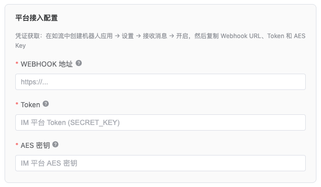
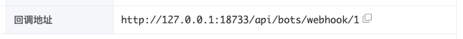

# 如流机器人接入指南

在如流创建群机器人，在 LockBot 为它配置资源。以下 LockBot 截图使用虚构数据，适合用来找页面和字段。

## 1. 在如流取得机器人凭证

在目标群使用有权限的账号创建或选择机器人应用。打开「机器人设置 → 接收消息」，开启消息接收，复制页面给出的 **Webhook URL、Token 和 AES Key**。保留该页面，稍后还要填 LockBot 的回调地址。

| 用途 | 从哪里复制 | 填到哪里 |
| --- | --- | --- |
| LockBot 向如流群发回复 | 如流机器人设置中的 **Webhook URL** | LockBot 创建表单的 **Webhook URL** |
| 如流将群消息发给 LockBot | LockBot 机器人详情中的 **回调地址** | 如流同一个机器人的 **接收消息**设置 |
| 校验和解密入站消息 | 如流机器人设置中的 **Token、AES Key** | LockBot 创建表单的 **Token、AES 密钥** |

## 2. 在 LockBot 创建资源机器人

1. 登录 LockBot 控制台，进入「我的机器人 → 创建机器人」。选择「如流 / Infoflow」。站点只开放如流时，普通用户可能直接看到如流表单。
2. 填写机器人名称和类型。首次验证可选 `NODE`，添加一个专用的虚构测试节点，如 `demo-node`。
3. 填入如流提供的 Webhook URL、Token 和 AES 密钥，保存。凭证仅填写在配置表单中。

## 3. 把 LockBot 回调地址填回如流

打开刚创建的 LockBot 机器人，在「配置信息 → 回调地址」点复制。将地址粘贴到第一步保留的如流「接收消息」设置，保存后检查 LockBot 机器人状态。如果没有自动启动，回到详情页点「启动」。

示例中的本机地址仅用于演示。实际回调地址应使用如流能够访问的 LockBot 部署地址。使用反向代理时，从配置好的对外入口打开详情页再复制。

## 4. 在测试群查询一次

在目标测试群使用如流的实际 @ 功能选中机器人，发送 `@机器人 query`。预期同一个群收到资源状态，包含所配置的 `demo-node`，且空闲节点显示为空闲。

如需进一步验证锁定和释放，确认 `demo-node` 空闲且专用于这次测试，再发送 `@机器人 lock demo-node 5m`。查询确认占用后，发送 `@机器人 unlock demo-node`，再次查询确认它恢复空闲。这里的节点名和结果是演示用例。

如果群里没有回消息，按顺序检查：

1. 群里 @ 的是这次设置的如流机器人，且已启用「接收消息」。
2. 如流填入的是当前 LockBot 机器人详情页上的回调地址。检查域名、端口和代理路由能否从如流访问。
3. LockBot 中机器人处于运行状态，Webhook URL、Token 和 AES 密钥均来自同一个如流机器人。已收到回调但未能回复时，检查签名校验和出站 Webhook 的结果。

资源群验证通过后，按 [Agent Skill 安装指南](resource-agent-helper.md) 安装完整 ZIP，再让 Agent 帮你绑定群身份、查看占用和申请资源。

本指南已用 v3.3.0 官方容器镜像和全新数据目录验证初始管理员登录、修改密码及启动如流 NODE 机器人。截图使用虚构配置，群内实际收发待在授权测试群验收。
